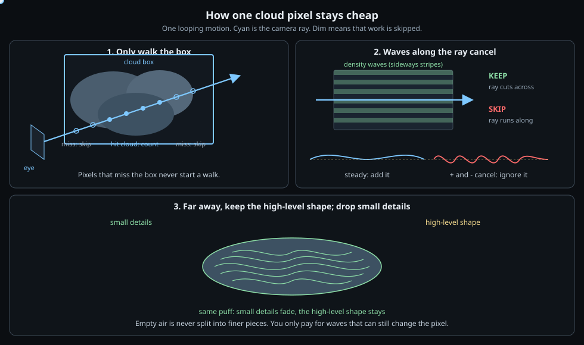

# bevy_fast_clouds

> **Vendored copy** of [steven-moss-notebook/bevy_fast_clouds](https://github.com/steven-moss-notebook/bevy_fast_clouds)
> (commit da82081) for Stealth Mission 89, changed for the game:
>
> - Drawn for every view with a `CloudCamera` (both VR eyes) between the opaque and the
>   transparent pass, into the view's own (multisampled, LDR or HDR) target, using Bevy's view
>   uniform; transparent glass, smoke and lights draw over the clouds.
> - Shading from a 16-entry colour ramp (`CloudShading`: the game's palette cloud ramp, sun,
>   haze, lightning) instead of the demo key/area/storm lights; `dither` draws whole ramp
>   colours with a 4x4 ordered dither (the game's classic look).
> - `CloudVolume::core`: solid sphere cores eroded by the ridges; march steps per LOD;
>   volumes sorted far to near; `WaveletVolume::with_floor` for flat cumulus bases.
> - The examples are not included; the notes below describe the upstream crate.


Hierarchical trigonometric wavelet volumes for real-time clouds in [Bevy](https://bevyengine.org).

This crate’s version tracks Bevy’s: `bevy_fast_clouds` **0.19.x** is for Bevy **0.19**.

| Bevy | `bevy_fast_clouds` |
| ---- | ------------------ |
| 0.19 | 0.19 |


A cloud is a box of overlapping blobs. For each pixel whose ray hits that box, the shader walks a fixed number of steps and adds density. That walk is the cost. This crate skips work that cannot show up in the pixel.

```bash
cargo run --example display_case
cargo run --example planet_approach
```

## Why the walk is cheap

**Miss the box, skip the pixel.** The GPU draws the cloud’s bounding box (Bevy fog-volume style): rasterize the crate around the puff, then march only those fragments.

**Stripes that line up with the ray cancel.** Density is families of sine stripes along a few fixed directions \(n\). A sine over whole periods averages to zero (\(\int_0^{2\pi}\sin\theta\,d\theta = 0\)). If \(n\) is almost parallel to the ray, the walk crosses many periods, so that direction is not evaluated.

**Far away, keep the high-level shape.** Coarse scale \(j=0\) is the overall puff; \(j=3\) is small details. When the box is small on screen those details are smaller than a pixel, so \(j_\max\) and the harmonic count \(H\) drop. Empty space is never split further.

Work per pixel is then roughly

\[
(\text{directions still on})\times(\text{scales still on})\times 2\text{ windows}\times H\times(\text{march steps}).
\]

Each remaining term is a short sine dot product.



The SVG is a 12s loop (open it in a browser if the preview is frozen). Cyan is the camera ray. Dim work is skipped.

## Display-case

Four clouds along a gallery. Same `LodPolicy`; distance sets `j_max` and `H_max`. Scripted camera path plus scroll zoom. Hero cloud: orbiting key, floor area light, in-volume storm pulses.

| Key | Action |
| --- | --- |
| Space | Pause path |
| Scroll | FOV zoom |
| L | False-color by `j_max` |
| R | Reset path |

## Planet-approach

Inbound over a cube-sphere planet, through a volume, then over eroded mountains. Sixteen cloud systems wrap the globe. Interior marches cap span and drop fine LOD.

## Crate layout

- `FastCloudsPlugin`, `CloudVolume`, `LodPolicy`, `CloudRenderSettings`
- `WaveletVolume::from_spheres` — occupancy from a sphere union
