# Stealth Mission 89 – User Manual

This manual describes the basic operation of the game: the main menu, the input mapping, the
cockpit, the displays, targeting, radar detection and the aircraft, air defences and ships in the
theaters. A complete list of keys is in [keys.md](keys.md).

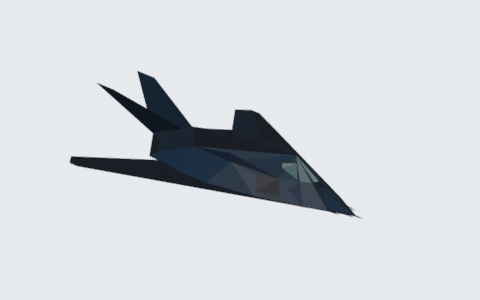

The player flies an F-117A or an F-16C (chosen in the menu's *Aircraft* section). Both have four
weapon bays (two with *Realistic weapons*), a 20 mm gun with 650 rounds, chaff, flares, decoys,
an ECM jammer and an IR jammer. The F-16C is faster (Mach 2 class at altitude), pulls 9 g and
rolls about twice as fast, but it has no weapon bay: its stores hang outside, so radars see it as
an F-117A with its bay doors always open (+24 EMV), and the bay door key does nothing. The F-117A
has a modern and a classic cockpit, the F-16C its own.

## Contents

1. [Main menu](#1-main-menu)
2. [Controls menu](#2-controls-menu)
3. [The cockpit](#3-the-cockpit)
4. [MFD pages](#4-mfd-pages)
5. [Targeting and weapons](#5-targeting-and-weapons)
6. [Radar, detection and evasion](#6-radar-detection-and-evasion)
7. [Keyboard shortcuts](#7-keyboard-shortcuts)
8. [Aircraft, air defences and ships](#8-aircraft-air-defences-and-ships)
9. [Mission planner](#9-mission-planner)
10. [Debrief and career](#10-debrief-and-career)
11. [Drone defense (Ukraine)](#11-drone-defense-ukraine)
12. [Ejection and rescue](#12-ejection-and-rescue)

---

## 1. Main menu

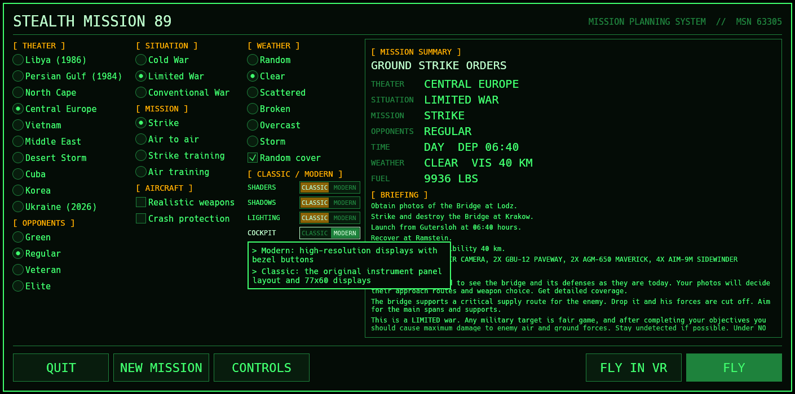

The menu generates a mission from the selected options. Every change creates a new mission, and the
summary on the right shows it. Hovering over an option shows a short description (in the picture,
the *Cockpit* switch).

| Section | Options |
|---|---|
| **Theater** | Libya (1986), Persian Gulf (1984), North Cape, Central Europe, Vietnam, Middle East, Desert Storm, Cuba, Korea, Ukraine (2026). |
| **Opponents** | Green, Regular, Veteran, Elite. Sets the skill of enemy pilots and SAM crews; Veteran and Elite add ships and patrols. Higher levels also increase radar sensitivity. |
| **Situation** | *Cold War*: covert peacetime operation, fewer enemy aircraft. *Limited War*: regional conflict, air defences on alert. *Conventional War*: full-scale war, all enemy forces active. The briefing states the exact rules of engagement. |
| **Mission** | *Strike*: ground target (destroy, photograph or reach), with a primary and a secondary objective. *Air to air*: intercept an enemy aircraft. *Strike training* and *Air training*: practice missions. *Drone defense* (Ukraine only): stop a wave of attack drones, then bomb their launch site (chapter 11). |
| **Aircraft** | *F-117A* or *F-16C*: the flown aircraft. *Realistic weapons*: two bays instead of four, no AIM-9/AIM-120, no carrier operations. *Crash protection*: automatic pull-up near the ground with the gear up; ground contact and collisions are not fatal. |
| **Weather** | Random (based on the theater's climate), Clear, Scattered, Broken, Overcast, Storm. *Random cover* off: a slider sets the coverage of the main cloud layer. Clouds block optical seekers and visual identification for both sides; radar sees through clouds. |
| **Classic / Modern** | *Shaders*: flat original shading or anti-aliasing, shading and haze. *Shadows*: sun shadows. *Lighting*: cockpit lamps, explosions, flares and runway lights light the scene. *Cockpit*: original panel or modern panel (this manual describes the modern panel). *HUD*: the original HUD, or a high-resolution F-16 style HUD in green. *Flight model*: original flight model, or an aerodynamic model with fly-by-wire: the stick commands pitch rate (up to 7 g) and roll rate; released, the nose stays where it was left and, once the flight path has caught up with it, the path is held (also in turns up to 60° of bank). Angle of attack and g limiters only act near the limits. |

The **mission summary** lists theater, situation, mission type, opponents, time of day and
departure time, weather, visibility and fuel. The **briefing** below it lists the objectives, the
departure and landing bases, the weather, the armament and intelligence notes.

The menu remembers its choices and switches for the next start.

| Button | Function |
|---|---|
| QUIT | Exit to the desktop. |
| NEW MISSION | Generate a different mission with the same options. |
| CONTROLS | Open the input mapping (chapter 2). |
| CAREER | Pilot records and the tour of duty (chapter 10). |
| PLAN ROUTE | Below the mission summary: the mission planner (chapter 9). |
| FLY IN VR | Restart the game in the VR headset with this mission (requires an OpenXR runtime). |
| FLY | Start the mission. |

## 2. Controls menu

The *Controls* button opens the input mapping. The mapping is saved automatically and applies
to all later flights.

- **Device list**: connected joysticks, throttles and gamepads.
- **Standard gamepad layout**: left stick for pitch and roll, right stick for rudder, triggers
  for throttle, face buttons for fire, gun, weapon select and bay doors.
- **Preview** (top right): an F-117 outline that moves with the mapped axes, with the throttle
  shown as the exhaust colour. If the aircraft moves the wrong way, enable *Invert* for that axis.
- **Axes**: Roll, Pitch, Rudder, Throttle, Sensor/cursor slew X and Y (modern avionics). Click **BIND**, then move the axis. *Invert* reverses
  the direction, *dead zone* sets the neutral range around the centre, and the bar shows the
  current value. **CLEAR** removes the binding.
- **Buttons**: every game action, with its keyboard key for reference. Click **BIND**, then press
  a button. A hat switch or an axis pushed past halfway can also be bound. **Esc** cancels the
  capture.
- **CLEAR ALL** removes all bindings; **DONE** closes the dialog.

**VR controllers**: the last section assigns an action to each VR controller input (trigger, A/X,
B/Y, stick click, stick directions) per hand. **DEFAULTS** restores the default assignment. A
trigger only counts while that hand holds the throttle (left) or the stick (right).

## 3. The cockpit

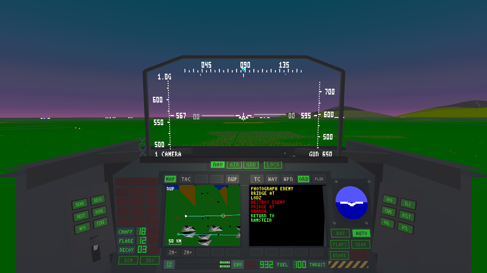

The view shows the head-up display (HUD) at the top and the instrument panel below it. Hold the
**right mouse button** to look around. **Click** a button on the panel to press it. Every button
has a keyboard equivalent (chapter 7).

For comparison, the **classic cockpit** (menu: *Cockpit: Classic*) uses the original panel with
the original 77×60-pixel displays and lit lamps instead of labelled bezel buttons:

The rest of this manual describes the modern cockpit.

### 3.1 HUD and HUD mode buttons

The modern HUD is drawn in green in the style of the F-16's:

* **Top:** heading tape (tens of degrees) with the caret of the current steerpoint.
* **Top left:** g load, Mach number and the highest g of the flight.
* **Left / right:** airspeed scale (knots) and altitude scale ("1,5" = 1,500 ft) with the boxed
  readouts; climb rate in feet per minute above the altitude box, radar altitude ("R") below it
  under 5,000 ft.
* **Centre:** gun cross at the boresight and the flight path marker (the circle with wings: where
  the aircraft is going). The pitch ladder is centred on the flight path marker: a rung every
  5°, solid above the horizon, dashed and bent below it. With the gear down, the bracket left of
  the marker shows the approach angle of attack: marker in the middle of the bracket = on speed,
  high = fast, low = slow.
* **Bottom:** bank angle scale; mode, selected weapon and gun rounds (left); steerpoint number,
  distance and time to go (right). Messages such as "*Dessau detected*" appear at the top.

The modes add their own symbols:

* **NAV:** a diamond on the steerpoint on the ground.
* **AA:** the target designator box with the missile diamond once locked, the range below it;
  with an air-to-air missile selected the steering circle and dot, *SHOOT* in range, and the
  launch zone scale (maximum and minimum range, target range caret); otherwise the gun pipper.
* **AG:** the target designator box (*IN RNG* in range); for bombs the CCIP pipper with the bomb
  fall line, and for guided release the azimuth steering line with the release cue that slides
  down to the flight path marker.

The **classic HUD** (menu: *HUD: Classic*) is the original's low-resolution HUD, as in the
classic cockpit picture above.

| Button | Function |
|---|---|
| NAV | Navigation mode: steering to the current waypoint. |
| AIR | Air-to-air mode: aircraft targets. |
| GND | Air-to-ground mode: ground targets. |
| LOCK | Lamp: blinks while a target is designated, steady when the target is within weapon range. Pressing it designates a target (as N). |

F2 cycles through the modes; V declutters the HUD.

### 3.2 Left side panel: targeting and weapons

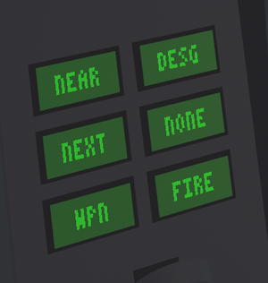

| Button | Key | Function |
|---|---|---|
| NEAR | T | Lock the nearest target ahead. AIR or GND mode depends on the selected weapon. |
| DESG | N | Designate a new target. |
| NEXT | B | Select the next target. |
| NONE | Shift B | Clear the target. No automatic acquisition until the next target or camera key. |
| WPN | Space | Select the next weapon bay. |
| MENU | Esc | Open or close the in-flight settings menu (chapter 3.8). |

The selected weapon is released with Enter, the gamepad's A button or the right VR trigger while
the hand holds the stick.

The lever below the buttons is the landing gear lever; its arm shows the gear position (down = gear down).

### 3.3 Warning lamps and countermeasures

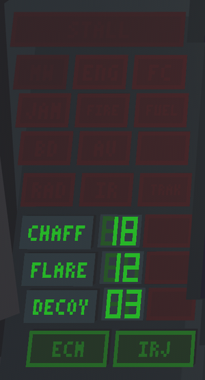

The lamps are dark when inactive. Their layout from top to bottom:

| Row | Lamps |
|---|---|
| 1 | **STALL** – airspeed below stall speed (blinks). |
| 2 | **MW** missile warning · **ENG** engine damage · **FC** fire control damage |
| 3 | **JAM** jammer damage (ECM and IRJ fail) · **FIRE** fire on board · **FUEL** fuel system damage |
| 4 | **BD** bay door damage (doors stay open) · **AV** avionics damage · (unused) |
| 5 | **RAD** radar-guided missile in flight · **IR** infrared missile in flight · **TRAK** enemy radar tracking the aircraft |

| Control | Key | Function |
|---|---|---|
| CHAFF | 2 | Release chaff. The counter shows the remaining stock; the lamp on the right lights on release. |
| FLARE | 1 | Release a flare. |
| DECOY | 5 | Release a decoy. |
| ECM | 4 | Radar jammer on/off (lit when on). |
| IRJ | 3 | IR jammer on/off (lit when on). Switches itself off after 20 s of continuous use and must cool down. |

### 3.4 Attitude indicator and aircraft systems

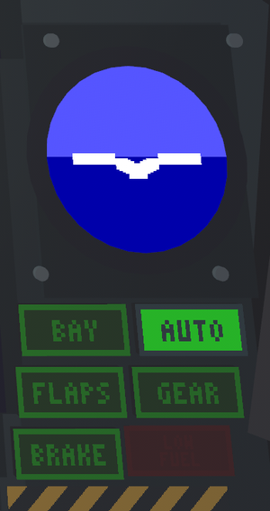

The attitude indicator (ball) shows pitch and bank. The buttons below it:

| Button | Key | Function |
|---|---|---|
| BAY | 8 | Weapon bay doors open/close. Weapons can only be released with open bays. |
| AUTO | 7 | Autopilot: flies to the current waypoint. |
| FLAPS | 9 | Flaps: extend over about 3 s; more lift and a higher angle of attack limit, about 20 % lower stall speed. |
| GEAR | 6 | Landing gear. |
| BRAKE | 0 | Wheel brakes on the ground, speed brake in the air. |
| LOW FUEL | – | Lamp: blinks below 1500 lbs of fuel. |

### 3.5 Right side panel

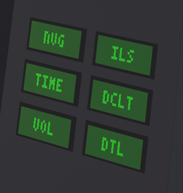

| Button | Key | Function |
|---|---|---|
| NVG | F4 | Night vision goggles. |
| ILS | F9 | Instrument landing system; shows the landing guidance on the right MFD. |
| TIME | Shift Z / Shift X | Time acceleration on/off. Acceleration ends automatically when a radar detects the aircraft or a weapon is released. |
| DCLT | V | HUD declutter. |
| VOL | Alt V | Sound level. |
| DTL | Alt D | Detail level. |

### 3.6 Bottom strip: radar bar graph, fuel and thrust

From left to right: the **EGR/EAR radar bar graph** (described in chapter 6.2), the **EMV** label
with the EMV warning lamp (lit for 2 s after each detection), **FUEL** (fuel in lbs divided by
10) and **THRUST** (in percent).

### 3.7 The F-16 cockpit

The F-16C has its own cockpit, laid out like the real one: the master mode (NAV, A-A, A-G) and
LOCK caps on the up-front controls under the HUD, the attitude indicator and the **HSI** (heading,
bearing pointer and distance to the current waypoint) under them, the MFDs low left and right,
the **RWR** scope top left with the aircraft system caps below it, the countermeasure panel top
right with the fuel and thrust readouts below it, and the warning lights on the eyebrows either side
of the HUD. The stick is on the right console, the throttle on the left one, with the side panel
buttons in front of them.

It has no radar bar graph. The **RWR** shows every radar that can see the aircraft, at its bearing
relative to the nose (up = ahead). Like a real RWR it does not show range: the closer a symbol is to
the centre, the more dangerous the radar (a launching or tracking SAM innermost, a radar only
searching near the rim). Symbols: the SAM type (`2` SA-2, `10` SA-10, `N6` SA-N-6, `HK` Hawk,
`RA` Rapier, ...), aircraft radars with a hat over their type (`29` MiG-29, `AW` AWACS); dim =
searching, bright = tracking, a diamond marks the most dangerous one, a flashing circle a missile in
the air.

### 3.8 In-flight settings menu

**Esc** (also Pause, Alt P, the gamepad's Start button or the **MENU** button of the left side
panel) opens the settings menu in front of the pilot and pauses the flight. In VR, touch an
entry with a fingertip and pull the trigger, or use a thumbstick and A / X. On the desktop, click
an entry or use the arrow keys and Enter (gamepad: d-pad and A, B closes).

| Entry | Function |
|---|---|
| Shaders | Modern (anti-aliasing, shading, haze) or classic flat shading. |
| Shadows | Sun shadows on / off. |
| Point lights | Cockpit lamps, explosions, flares and runway lights lighting the scene. |
| Cockpit | Modern or classic panel (F-117A only). |
| HUD | Modern (F-16 style) or classic HUD. |
| Avionics | Modern (F-16 style MFD formats, chapter 4.1) or classic MFD pages. |
| Cockpit size | VR only: size of the cockpit in the headset (70–150 %, default 100 % = 70 % of life size); left / right or the < > halves. |
| Resume | Closes the menu (as does Esc again). |
| End mission | Ends the flight and goes to the debrief. |

Changes apply at once and are saved as the defaults for the next flight.

## 4. MFD pages

The panel has two multi-function displays (MFDs). With the **classic avionics** (menu: Classic /
Modern, Avionics) they show the original's pages described here; the **modern avionics** are in
chapter 4.1. The labelled buttons above and below each screen select the pages and their
functions. The button of the active page is lit.

| Left MFD buttons | Function |
|---|---|
| MAP / TAC | Select the page (key F3 toggles). |
| NUP / HUP | Map orientation: north up or heading up (Alt F3). |
| ZM- / ZM+ | Zoom out / in (Alt X / Alt Z). |

| Right MFD buttons | Function |
|---|---|
| TC | Tracking camera. |
| WAY | Waypoints (F7). |
| WPN | Weapons (F5). |
| ORD | Mission orders (F10). |
| FLIR | Thermal camera on/off (F6). |
| Lower row | Page functions, see below. |

<table>
<tr>
<td width="50%">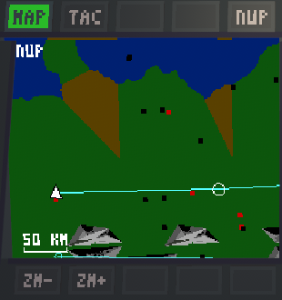 
<b>MAP</b> – Top-down map of the theater with the own aircraft (triangle), the route and
waypoints, airbases and ground objects. A scale bar is shown at the bottom left. During a radar
sweep, the map shows the radar's coverage (chapter 6.3).</td>
<td width="50%">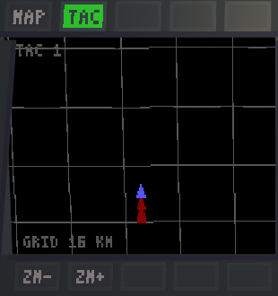 
<b>TAC</b> – Heading-up tactical display with a grid (spacing shown at the bottom). Own aircraft
in blue. Other aircraft are shown as triangles pointing in their direction of flight: red at
the same altitude (±1000 ft), dark red below, yellow above. Missiles are shown as short lines;
radar sites, airbases and targets as icons.</td>
</tr>
<tr>
<td>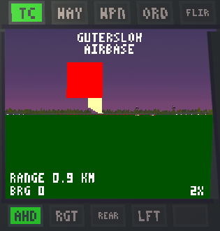 
<b>TC</b> – Tracking camera. Shows the current target with its name, range, bearing and
zoom factor. AHD / RGT / REAR / LFT (keys / , . M) point the camera ahead, right, rear or left;
each press also picks the nearest object in that direction. The last bottom button sets the zoom
(AUTO by range, then 1X..6X; also `[` / `]`).</td>
<td> 
<b>WAY</b> – Mission time and waypoint table: distance (km), flight time (minutes) and ETA for
each waypoint; fuel bar at the bottom. WP- / WP+ (PgUp / PgDn) select the waypoint, RST
(Shift F8) resets it to its original position.</td>
</tr>
<tr>
<td> 
<b>WPN</b> – Weapon bays with their load and count; the selected bay is highlighted.
SEL (Space) selects the next bay.</td>
<td> 
<b>ORD</b> – Mission orders: primary objective (yellow), secondary objective (red), landing
base (green).</td>
</tr>
<tr>
<td> 
<b>FLIR</b> – The tracking camera as a black-and-white thermal picture: aircraft, vehicles and
buildings appear bright.</td>
<td></td>
</tr>
</table>

### 4.1 Modern avionics

With the modern avionics either MFD can show any of five F-16 style formats, chosen with the
bottom row of bezel buttons: **HSD**, **HARM**, **TGP**, **MAP** and **SMS**. The buttons'
functions are written on the display next to them (lit = selected); the bezel caps are blank.
Choosing the format the other MFD shows swaps the two. F3 cycles the left MFD through HSD, MAP
and HARM; F5 / F10 bring up SMS, F6 and the camera keys the TGP, F7 the waypoint table.

| Format | Top row buttons | Shows |
|---|---|---|
| HSD | DEP / CEN, RNG-, range, RNG+, SOI | Horizontal situation display, heading up: range rings (the range in km is the outer ring), the route with the current steerpoint ringed, SAM sites with their missile's reach as red threat rings, hostile (red) and friendly (green) aircraft, missiles, the mission targets (cyan diamonds); the locked target is boxed. |
| HARM | ALL / SAM / AIR, SOI | The radars painting the aircraft, like the RWR: at their bearing, the most dangerous nearest the centre (chapter 3.7). |
| TGP | FLIR, ZM-, ZM+, CZ, SOI | The targeting pod (tracking camera), see below. The pod's mode (SLV / AREA / PNT) is shown bottom left, the zoom bottom right (AUTO: by range). |
| MAP | NUP / HUP, ZM-, ZM+, WAY | The moving map in muted colours; WAY switches to the waypoint table (WP-, WP+, RST). |
| SMS | WPN, ORD, SEL | Stores (WPN) and mission orders (ORD). |

**Sensor of interest (SOI).** The HSD, the HARM display or the TGP is the SOI (white frame; the top right
SOI button, or Alt S to move it to the other MFD). Its cursor, two short vertical lines, moves with
the **sensor/cursor slew** controls: the keypad (8 / 2 / 4 / 6 and diagonals), the left VR
thumbstick, or two joystick axes bound in the CONTROLS dialog ("Sensor/cursor slew X/Y"). **Lock
cursor target** (keypad Enter, left thumbstick click, or a bound button) locks what is under the
cursor: an aircraft on the HSD (the HUD goes to A-A), a ground object or SAM site (A-G), or a
radar on the HARM display. The lock holds until the next target key (B, T, N, Shift B or the
camera keys). Z / X change the HSD range while it is the SOI.

**Targeting pod.** The TGP follows the locked target (SLV); without one it looks ahead and down,
or where the camera keys turn it. Made the SOI, the slew controls turn the pod itself (AREA, slower
when zoomed in); a moment after the slew stops it holds the ground point it looks at (PNT), wherever
the aircraft flies. **Lock cursor target** then locks what is at that point (the ground itself if
nothing is there) and the pod follows the lock again. CZ returns it to SLV and the zoom to AUTO.
ZM- / ZM+ (also `[` / `]`, and Z / X while the pod is the SOI) zoom it from 1X to 6X. The HSD shows where
the pod looks: a green diamond on its ground point with a dashed line from the aircraft.

## 5. Targeting and weapons

The picture shows a ground target locked in GND mode: the HUD box marks the target, the TC page
shows the target (here *Gutersloh Airbase*, 0.9 km), and the GND lamp is lit.

**Procedure**

1. Select the weapon with **WPN** (Space). The HUD shows it at the bottom left.
2. Lock a target: **NEAR** (T) for the nearest target ahead, **DESG** (N) to designate,
   **NEXT** (B) to step through targets. The camera keys (/ . , M) also select targets in
   their direction.
3. Open the bay doors (**BAY**, 8).
4. Release with Enter (gamepad A, VR: right trigger) when **LOCK** is steady. Releases fail with *Bay closed*,
   with a bank angle above about 67°, or on the ground (*Insufficient Altitude*).
5. Close the bay doors. Open doors increase the radar signature (chapter 6.1).

The gun (Backspace) fires along the nose.

Ground targets under cloud cannot be designated (*Target obscured*). IR and optical seekers
(AIM-9, Maverick, laser-guided bombs) need a clear line of sight.

**Player weapons** (lock range in km):

| Weapon | Type | Range |
|---|---|---|
| AIM-9M Sidewinder | IR air-to-air missile | 17 |
| AIM-120A AMRAAM | Radar air-to-air missile | 32 |
| AGM-88A HARM | Anti-radiation missile, only against radar sites | 20 |
| Penguin 3 / AGM-84A Harpoon | Anti-ship missiles, only against ships | 32 / 60 |
| AGM-65D Maverick | Optical air-to-ground missile | 32 |
| GBU-12 Paveway, Mk 20 Rockeye II, CBU-72 FAE | Guided bombs | 10 |
| Durandal, Mk 82-1 Snakeye, Mk 20 Rockeye, Mk 35, Minelets | Retarded / cluster bombs | – |
| Mk 82-0 Slick, Mk 122 Fireye | Free-fall bombs | – |
| 135 mm camera | Reconnaissance photos of the target | – |
| Extra fuel | 1900 lbs, transferred on release | – |

## 6. Radar, detection and evasion

### 6.1 How detection works

Each radar sweep produces a **signal** against the aircraft. The aircraft itself has an
electromagnetic visibility (**EMV**). The aircraft is detected when **signal + EMV exceeds 100**.

**EMV** increases with:
- altitude (higher = larger),
- speed (500 kt adds about 13),
- bank angle (90° bank adds 32),
- open bay doors (+24),
- ECM switched on (+16).

**Radar signal** depends on:
- **Distance**: the signal decreases linearly with distance and reaches zero at the radar's
  maximum range.
- **Terrain under the aircraft**: open sea gives the strongest signal, normal land less, hills
  half of that. Over **mountains** no radar can detect the aircraft.
- **Height above the radar**: an aircraft high above a nearby radar is in the blind cone above
  it. Example: at 10,000 ft above the site, radars closer than about 10 km cannot see the aircraft.
- **Aspect and radar type** (see 6.4).
- **Difficulty**: higher opponent levels make radars more sensitive.

**Consequences of detection**: the site's alert level rises, the RWR tone sounds, the EMV lamp
lights and time acceleration stops. A site that stays alerted raises a theater-wide alarm, starts
tracking (**TRAK** lamp) and launches missiles when the aircraft is within its missile's lock
range. After repeated detections the HUD reports "*Radar ID*". Signals below the threshold only
produce a short tone, and the site's alert level decreases with each sweep that does not detect
the aircraft.

Enemy fighters that detect the aircraft by radar can identify it visually within about 8 km by
day and 4 km by night (not through clouds).

### 6.2 The radar bar graph (F-117A)

The bar graph has two strips of LED segments:
- **EGR** (upper strip): signal of the last **ground** radar sweep.
- **EAR** (lower strip): signal of the last **airborne** radar sweep.

The radar signal lights segments from the **left in yellow**. The own **EMV** lights segments from
the **right in green**. Segments lit by both turn **red**: the two values add up to more than 100
and the **aircraft is detected**. A gap between the yellow and the green segments is the remaining
margin.

In the picture, an airborne radar (lower strip, yellow) is sweeping the aircraft; the EMV (green)
is low and the bars do not meet, so the aircraft is not detected.

The classic cockpit shows the same values in a single gauge: the EMV as a red bar from the right
(the blue remainder is the margin), with the EGR and EAR signal bars growing from the left over it.

### 6.3 Radar coverage on the map

During a sweep, the MAP page draws the radar's coverage as a circle around the radar. Its
radius is the distance at which that radar detects the aircraft **with its current EMV**. If
the own aircraft symbol is inside the circle, the aircraft is detected. A searching radar
shows a full circle; an alerted ground site shows a 90° sector pointing towards the aircraft.

Colours: ground radars dark red (weak), red (strong), yellow (detected); airborne radars cyan
(not detected) or white (detected). The picture shows an airborne radar (cyan circle); the
aircraft (white triangle, left) is outside the circle and not detected.

### 6.4 Radar types

| Type | Users | Strongest signal | Weakest signal |
|---|---|---|---|
| **Pulse radar** | SA-2, SA-5, SA-8B, SA-11, SA-13, SA-N-5, SA-N-7, Rapier, Tiger, Seacat; MiG-17, MiG-21, MiG-23, MiG-25, F-4E, F-5, Yak-38 | Aircraft seen from the side (beam aspect) | Aircraft flying directly towards or away from the radar |
| **Doppler radar** | SA-10, SA-12, SA-N-4, SA-N-6, Hawk, OTH radar; MiG-29, MiG-31, Su-27, F-14, Mirage F-1, IL-76 | Aircraft flying directly towards or away from the radar, at high speed | Aircraft flying at right angles to the radar (beam), at low speed |

Ground radars sweep all around. Fighter radars only see within about 67° either side of the
fighter's nose. The IL-76 airborne radar sees all around.

### 6.5 Evading radar

- **Keep EMV low**: fly low, at moderate speed and with small bank angles. Keep the bay doors
  closed until just before release. Switch ECM on only against missiles in flight, because it
  raises EMV.
- **Use the terrain**: fly over mountains and hills. Avoid flying over open sea near radars.
- **Fly the right aspect**: point the nose towards or away from **pulse** radars. Fly at right
  angles to **Doppler** radars and reduce speed.
- **Watch the bar graph**: if the yellow and green bars approach each other, change heading,
  descend or slow down.
- **Watch the map**: keep the aircraft symbol outside the coverage circles. Stay out of the
  forward sector of enemy fighters.
- **Keep distance**: the signal drops with range. A site out of missile lock range can detect
  but not engage.

### 6.6 Defeating missiles

The RAD and IR lamps show which kind of missile is in flight; MW warns of a missile.

| Missile guidance | Examples | Countermeasures |
|---|---|---|
| Radar command guidance | SA-2, SA-5, Tiger, Seacat | Chaff; ECM (always effective). |
| Semi-active radar | SA-8B, SA-11, SA-N-4, SA-N-7, Hawk, Rapier, AA-6, AA-7, AA-9, AIM-7 | Chaff; ECM beyond a minimum distance. |
| Active radar | SA-10, SA-12, SA-N-6, AA-10 (MiG-29/IL-76 in Central Europe, North Cape, Ukraine) | ECM beyond a minimum distance; chaff only while flying at right angles to the missile. |
| Infrared, all-aspect | AA-2, AA-6 (IR), SA-N-5 | Flares; IR jammer (always effective). |
| Infrared, rear-aspect (can only lock on from behind the aircraft) | SA-13, AA-8, AA-10 (IR), AIM-9W | Flares; IR jammer beyond a minimum distance. |

The minimum distance for ECM and IR jammer is about 6 km (Green), 10 km (Regular), 14 km
(Veteran) and 18 km (Elite). A **decoy** draws missiles and the alarm position away from the
aircraft while it is active. A radar-guided missile more than about 8 km from the aircraft loses
guidance when its launcher stops tracking the aircraft. Bringing the signal + EMV below 100
therefore also defeats missiles at long range.

## 7. Keyboard shortcuts

The input mapping (chapter 2) shows all keys and can bind them to joystick buttons.

| Group | Action | Key |
|---|---|---|
| **Flight** | Stick (pitch / roll) | Arrow keys; double-tap for full deflection |
| | Stick sensitivity | Ins |
| | Throttle up / down | `=` / `-` |
| | Full / idle throttle | Shift `=` / Shift `-` |
| | Gear / autopilot / bay doors / flaps / brakes | 6 / 7 / 8 / 9 / 0 |
| | Eject | Shift F10 |
| **Weapons** | Select weapon / fire / gun | Space / Enter / Backspace |
| | Flare / chaff / IR jammer / ECM / decoy | 1 / 2 / 3 / 4 / 5 |
| **Targeting** | Nearest target ahead | T |
| | Slew the SOI's cursor / lock the target under it / SOI to the other MFD (modern avionics) | keypad 1–9 / keypad Enter / Alt S |
| | Designate new target / next target / clear target | N / B / Shift B |
| | Tracking camera ahead / rear / right / left | `/` / `.` / `,` / M |
| | Tracking camera zoom in / out | `]` / `[` |
| **Displays** | HUD mode / declutter | F2 / V |
| | MAP / TAC (left MFD) | F3 |
| | Map zoom in / out, north up / heading up | Alt Z / Alt X / Alt F3 |
| | Night vision goggles | F4 |
| | Weapons page / FLIR / ILS / mission orders | F5 / F6 / F9 / F10 |
| **Navigation** | Waypoint page / change waypoint / reset waypoint | F7 / F8 / Shift F8 |
| | Previous / next waypoint | PgUp / PgDn |
| **Views** | Cockpit | F1 |
| | Look ahead / rear / left / right | Shift `/` / Shift `.` / Shift `,` / Shift M |
| | Slot / chase / side / missile / tactical / inverse tactical | Shift F1 … Shift F6 |
| | Zoom / unzoom / wide angle | Z / X / C |
| | Look around (cockpit) / orbit (external views) | Right mouse button |
| **Time** | Time acceleration / normal | Shift Z / Shift X |
| **Game** | Settings menu (pauses) / detail / sound level | Esc, Pause, Alt P, gamepad Start / Alt D / Alt V |
| | Training / resupply / quit | Alt T / Alt R / Alt Q |

## 8. Aircraft, air defences and ships

Ranges are the values the game uses, in km. **Radar range** is the distance at which the radar
signal reaches zero; **lock range** is the distance within which a missile is launched.
Theaters: LB Libya, PG Persian Gulf, NC North Cape, CE Central Europe, VN Vietnam, ME Middle
East, DS Desert Storm, CU Cuba, KO Korea, UA Ukraine. Enemy fighters also use their guns at
close range.

### 8.1 Aircraft

| | Aircraft | Description |
|---|---|---|
| 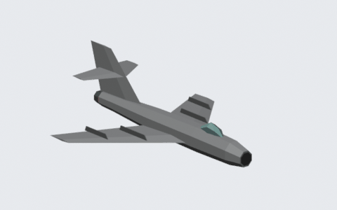 | **MiG-17 Fresco** | Older fighter. Pulse radar, 50 km. Armament: AA-2 (IR, 14 km) in DS; guns only in CU and KO. |
| 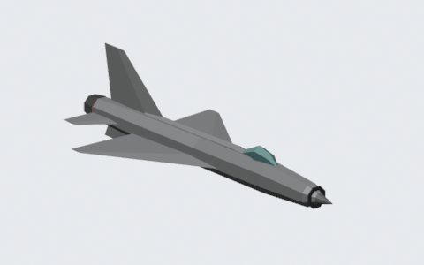 | **MiG-21 Fishbed** | Light fighter. Pulse radar, 40 km. Armament: AA-2 (IR, 14 km); AA-6 (IR, 50 km) in DS. Theaters: CU, KO, DS. |
| 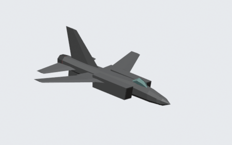 | **MiG-23 Flogger** | Fighter, the most common type. Pulse radar, 50 km. Armament: AA-2 (IR, 14 km) in CU, KO, DS, LB, ME; AA-8 (IR rear-aspect, 12 km) in CE; AA-6 (radar or IR, 50 km) in VN. |
| 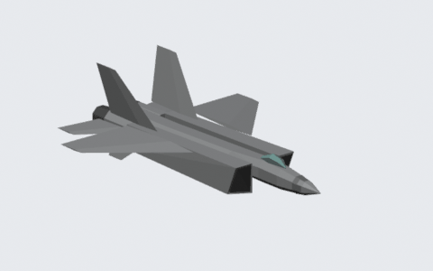 | **MiG-25 Foxbat / MiG-31 Foxhound** | Interceptors (same model). MiG-25: pulse radar 70 km, AA-6 (semi-active radar or IR, 50 km); CE, LB, NC. MiG-31: Doppler radar 100 km, AA-9 (semi-active radar, 82 km) in CE, NC, UA; AA-6 in ME, UA. |
| 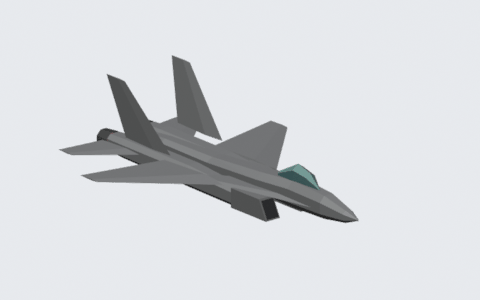 | **MiG-29 Fulcrum** | Fighter. Doppler radar, 80 km. Armament: AA-10 (active radar, 64 km) in CE, NC; AA-10 (IR rear-aspect, 64 km) in CU, KO, DS, LB, ME. |
| 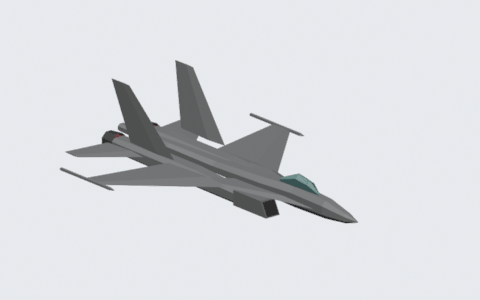 | **Su-27 Flanker** | Fighter. Doppler radar, 80 km. Armament: AA-10 (IR rear-aspect, 64 km). Theaters: CE, KO, NC, UA. |
|  | **Su-34 Fullback / Su-35 Flanker-E** | Ukraine's strike fighter and fighter (drawn with the Su-27 model). Su-34: Doppler radar 80 km, AA-8 (IR rear-aspect, 12 km). Su-35: Doppler radar 100 km, AA-10 (active radar, 64 km). Theater: UA. |
| 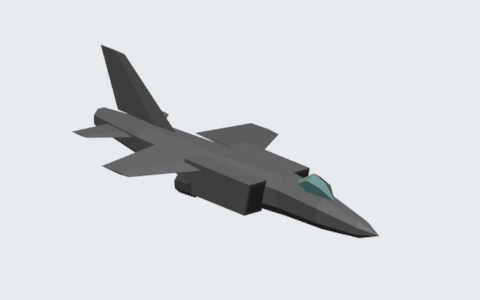 | **Yak-38 Forger** | Carrier-based fighter. Pulse radar, 50 km. Armament: AA-2 (IR, 14 km) in VN; AA-8 (IR rear-aspect, 12 km) in NC. |
| 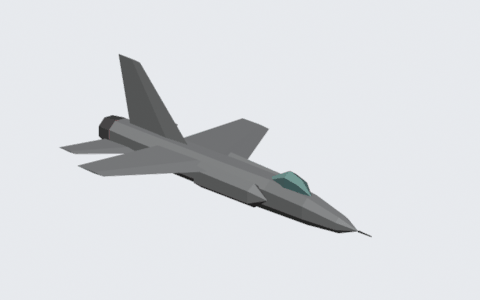 | **Mirage F-1** | Fighter (Iraq). Doppler radar, 100 km. Armament: AA-6 (semi-active radar, 50 km). Theater: DS. |
| 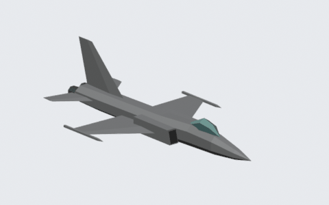 | **F-5 Tiger** | Light fighter. Pulse radar, 40 km. Armament: AA-2 (IR, 14 km) in ME; AIM-7 (semi-active radar, 44 km) in PG. |
| 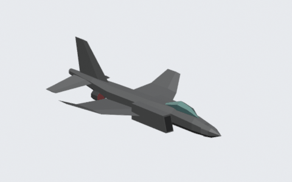 | **F-4E Phantom** | Fighter. Enemy in PG: pulse radar 70 km, AIM-9 (IR rear-aspect, 12 km). Friendly and unarmed in CE, CU, KO, NC, UA, VN. |
| 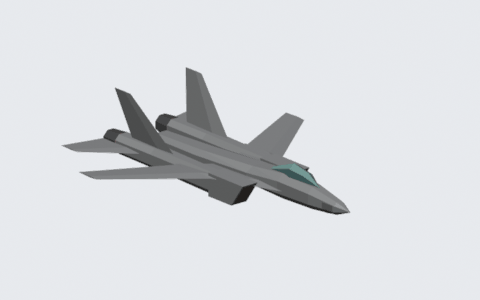 | **F-14 Tomcat** | Fighter (Iran). Doppler radar, 80 km. Armament: AIM-9 (IR rear-aspect, 12 km). Theater: PG. |
| 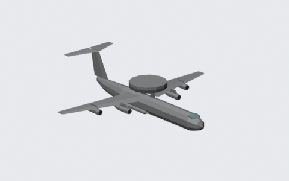 | **IL-76 Mainstay** | Airborne early warning aircraft. Doppler radar, 200 km, sees all around. Armament listed: AA-10 (active radar, 64 km). Theaters: CE, NC, UA. |
| 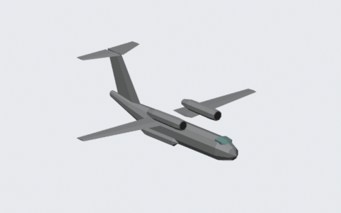 | **An-72 Coaler** | Transport. No radar, unarmed. All theaters; a typical air-to-air mission target. |
| 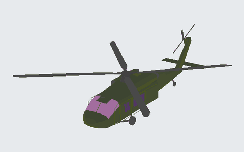 | **Mi-24 Hind** | Attack helicopter (drawn with the UH-60 model). Flies low, hovers, guns a low and slow player at close range; hunts a downed pilot (chapter 12). |
|  | **UH-60 Black Hawk** | Friendly rescue helicopter (chapter 12). |
| 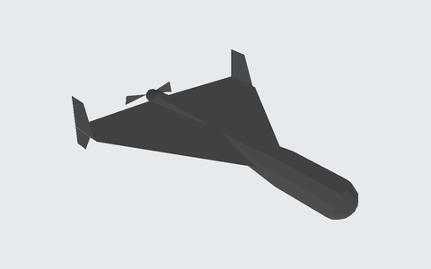 | **Geran-2** (Shahed-136) | Attack drone (Ukraine). Piston engine and pusher propeller, about 185 km/h, low. No radar, unarmed: it flies straight at its target and dives into it. Shown on the TAC display as an open delta. |
| 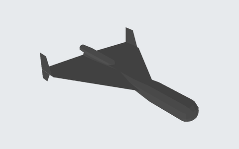 | **Geran-3** (Shahed-238) | The jet version: about 600 km/h, flies higher. Otherwise like the Geran-2. |
| 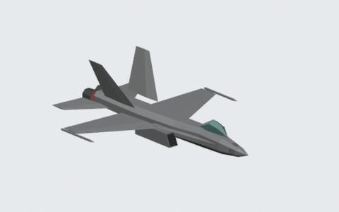 | **F/A-18 Hornet** | Friendly fighter. No threat. LB, ME, NC, PG, CE, UA. |
| 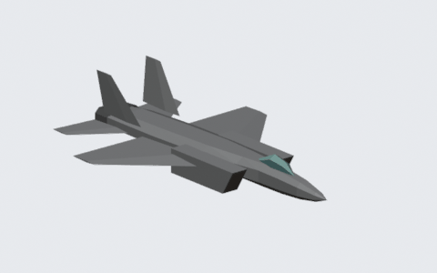 | **F-15 Eagle** | Friendly fighter. No threat. DS. |
| 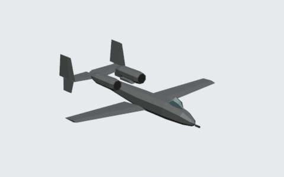 | **A-10 Thunderbolt II** | Friendly ground attack aircraft. No threat. DS. |

### 8.2 Air defences

SAM sites appear on the map as radar sites. The site model differs by theater; the SAM type
determines radar and missile:

| CE / UA | LB | PG | KO | VN | DS |
|---|---|---|---|---|---|
| 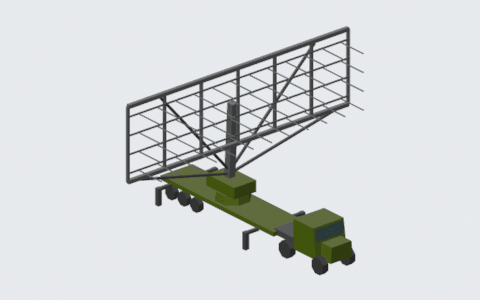 | 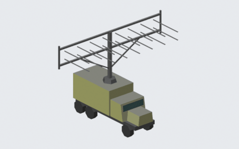 | 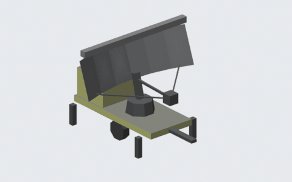 | 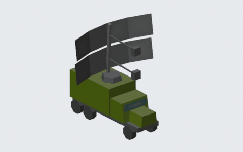 | 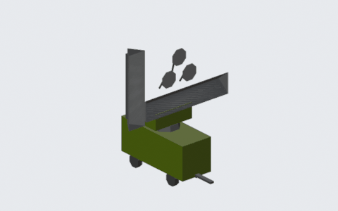 | 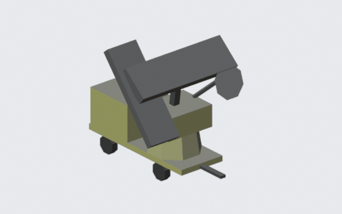 |

| SAM | Radar | Radar range | Missile guidance | Lock range | Theaters |
|---|---|---|---|---|---|
| **SA-2** | Pulse | 200 | Radar command | 125 | CU, KO, DS, LB, ME, VN |
| **SA-5** | Pulse | 350 | Radar command | 150 | CE, CU, KO, DS, LB, ME, NC, VN |
| **SA-8B** | Pulse | 125 | Semi-active radar | 65 | KO |
| **SA-10** | Doppler | 320 | Active radar | 125 | CE, KO, NC, UA |
| **SA-11** | Pulse | 200 | Semi-active radar | 100 | CE |
| **SA-12** | Doppler | 250 | Active radar | 125 | CE, KO |
| **SA-13** | Pulse | 125 | IR (rear-aspect) | 65 | CE |
| **SA-21** (S-400) | Doppler | 400 | Active radar | 200 | UA |
| **SA-17** (Buk-M2) | Doppler | 250 | Semi-active radar | 110 | UA |
| **SA-22** (Pantsir) | Doppler | 130 | Semi-active radar | 60 | UA |
| **SA-15** (Tor-M2) | Doppler | 125 | Semi-active radar | 50 | UA |
| **Hawk** | Doppler | 175 | Semi-active radar | 125 | PG |
| **Rapier** | Pulse | 75 | Semi-active radar | 65 | PG |
| **Tiger** | Pulse | 65 | Radar command | 30 | PG |

| | Radar | Description |
|---|---|---|
| 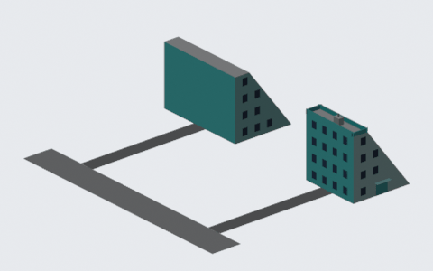 | **OTH / LPAR radar** | Over-the-horizon and large phased-array early warning radars. Doppler, 500 km. No missiles; a detection raises the theater-wide alarm. CE, UA (OTH), NC (LPAR). |

### 8.3 Ships

| | Ship | Description |
|---|---|---|
| 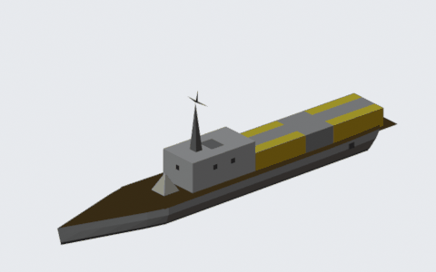 | **Missile boat / Patrol boat** | Armed with ship-based SAMs. Missile boat: SA-N-4 (Doppler 200 km, semi-active radar, 30 km), SA-N-5 (pulse 150 km, IR, 30 km) in LB, CU, KO; SA-N-6 (Doppler 320 km, active radar, 125 km) in KO; Seacat (pulse 200 km, radar command, 30 km) in PG. Patrol boat: SA-N-5, SA-N-7 (pulse 200 km, semi-active radar, 100 km) in CE, UA. |
| 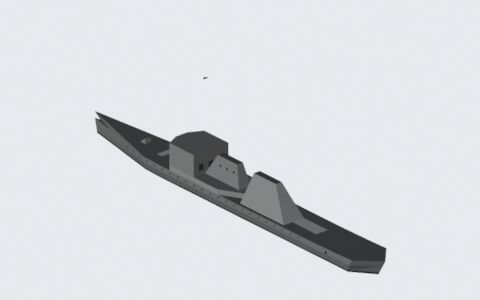 | **Destroyer** | Warship. LB, PG, NC, VN, ME, DS, CU, KO. |
| 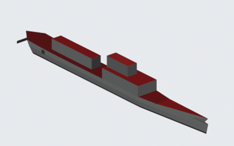 | **Krivak** | Soviet frigate. NC. |
| 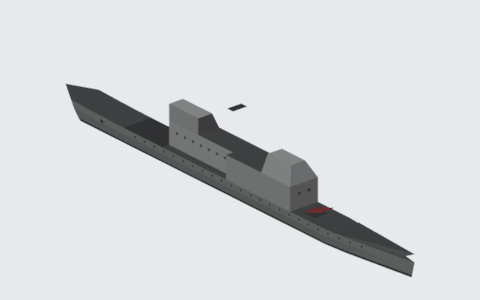 | **Aegis cruiser** | Cruiser. PG. |
| 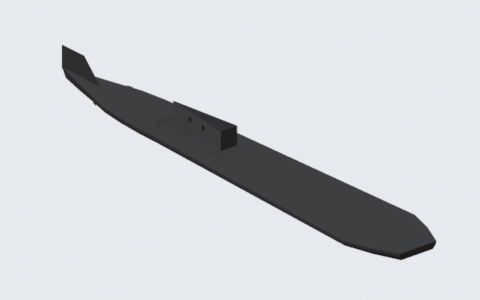 | **Typhoon** | Soviet ballistic missile submarine (surfaced). NC. |
| 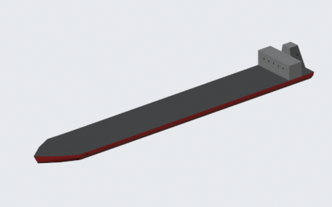 | **Oil tanker** | Tanker. LB, PG, CU. |
| 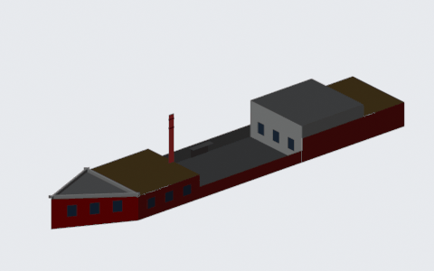 | **Cargo ship** | Freighter. NC; merchant ships also appear in CU, ME, DS and KO. |
| 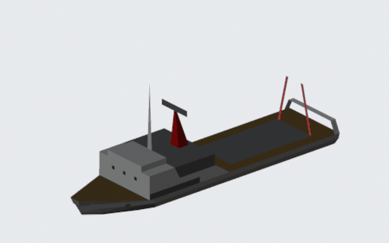 | **Trawler** | Intelligence trawler. CU. |
| 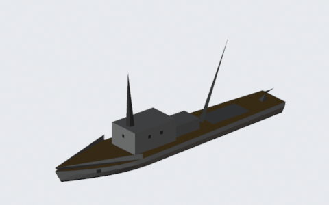 | **Armed fishing boat** | KO. |
| 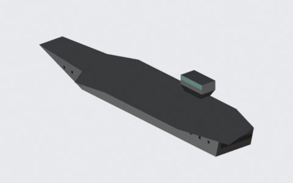 | **Aircraft carrier** | US carriers (USS America, Nimitz, Kennedy, ...). Friendly; takeoff and landing base in carrier missions (not with *Realistic weapons*). |

Only the missile boats and patrol boats carry air defences. The other ships have no air defences in
the game.

## 9. Mission planner

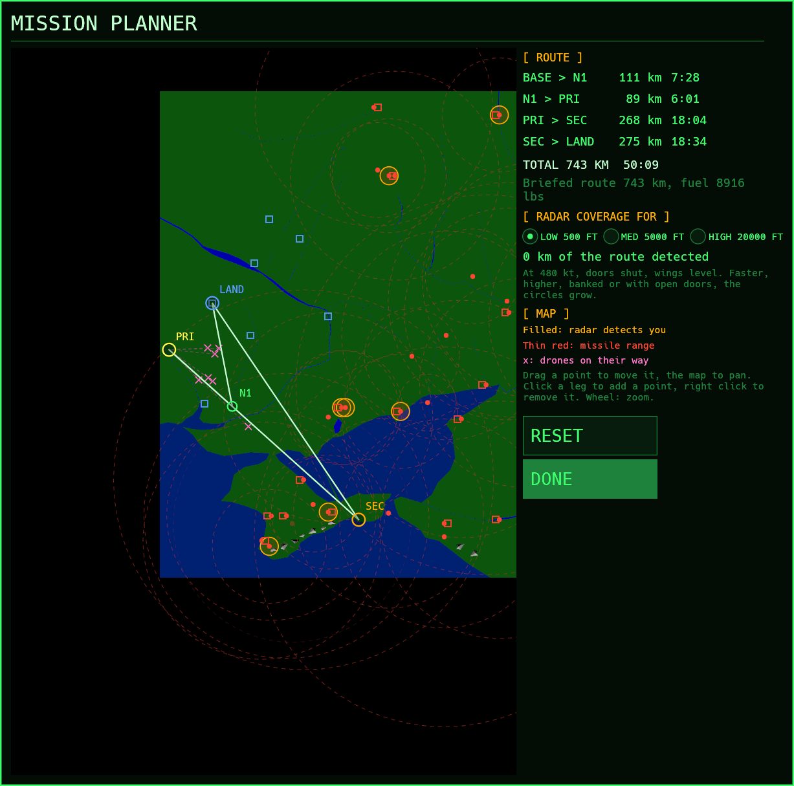

*Plan route* in the menu opens the theater map with the mission's route. The targets and the
landing base stay where they are; between them you add, move and remove navigation points:

| Action | |
|---|---|
| Click a leg | Add a point there (up to 16 points). |
| Drag a point | Move it. |
| Right click a point | Remove it. |
| Drag the map, mouse wheel | Pan, zoom. |
| RESET | Back to the briefed route. |

Each SAM site shows its missile range as a thin red circle and, filled, where its radar would
detect you, flown at the selected profile (*Low* 500 ft, *Medium* 5000 ft or *High* 20,000 ft, at
480 kt with the bay doors shut and wings level; banking, opening the doors, the ECM jammer and
speed make the circles larger). Sites that are off the air are drawn faint. The panel lists the
legs with distance and time and how many km of the route a radar would see. In drone defense
missions the drones' starting points are marked.

In flight the INS and the autopilot follow the planned route. When a target is done, the next
waypoint is the point after it, so the planned way home is flown as well. The planned route also
goes along with *Fly in VR*.

## 10. Debrief and career

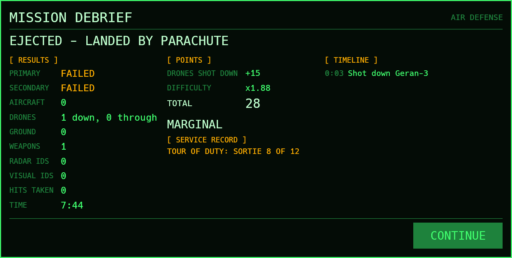

After every flight the **debrief** shows the result, the statistics, the points and a rating, and
a timeline of the mission (kills, radar and visual identifications, objectives). Points: primary
objective 100, secondary 50, each aircraft or ground target 10 (+5 for an aircraft shot down
before it saw you), each drone 15; −5 for each identification, −10 for each missile hit; landing
+25, crash −50, captured −100. The sum is multiplied by the difficulty (opponents and situation;
training missions count half).

**Career.** *Career* in the menu keeps pilot records: enlist a pilot by name, then start a
**tour of duty**, 12 sorties in the theater, situation and opponents chosen in the menu. The menu
then shows the tour's next sortie; changing an option leaves career mode (*Fly next sortie* in
the career window returns to it). In a tour:

- What you destroy stays destroyed for the rest of the tour, and new targets are never ones you
  already hit.
- Points add up to promotions: First Lieutenant 300, Captain 800, Major 1800, Lieutenant Colonel
  3500, Colonel 6000. A finished tour earns 200 extra points.
- A mission can earn the Air Medal (150 points), Distinguished Flying Cross (300), Silver Star
  (500), Air Force Cross (800) or Medal of Honor (1200); hits taken earn the Purple Heart.
- A crash or failed ejection ends the career (killed in action); so does being captured after an
  ejection (prisoner of war).

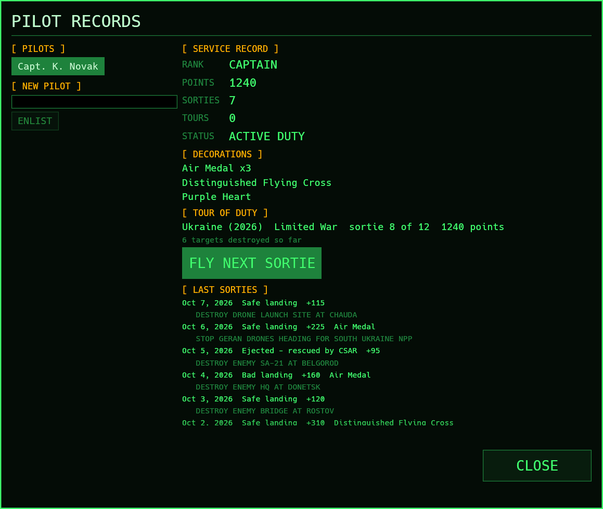

Single missions from the menu do not count for any pilot.

## 11. Drone defense (Ukraine)

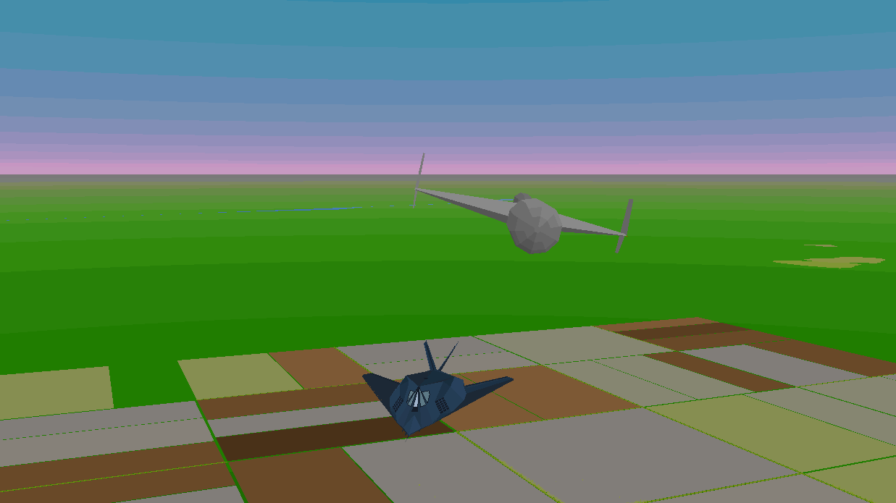

Russian Geran attack drones are on their way to a Ukrainian city or the South Ukraine nuclear power
plant. They start already in the air and arrive one after another, about 9 to 25 minutes after
take-off. You take off from the nearest airfield with air-to-air missiles, the gun and two
Paveways (with *Realistic weapons*: the gun, the Paveways and extra fuel).

- The **primary objective** is met when every drone is down or through and no more than the
  briefed number got through. A drone that hits the nuclear power plant fails the mission.
- The **secondary objective** is the launch site the drones came from.
- The early warning network shows every drone on the TAC display (open deltas) and on the map.
  They have no radar and do not fight back, but the Geran-2 is small, slow and low: slow down
  behind it and use the gun or a Sidewinder.
- Opponents and situation set the size of the wave (4 to 12) and the share of the faster jet
  Geran-3.

<table>
<tr>
<td width="40%"> 
The drones (crosses) on the MAP page, on their way to Poltava.</td>
<td width="60%"> 
An AMRAAM fired from 120 m behind hits the Geran-3.</td>
</tr>
</table>

In Ukraine strike missions a few drones may also cross the theater; shooting them down earns points.

## 12. Ejection and rescue

After a good ejection over enemy territory (Shift-F10, or the ejection handle in the cockpit) the
mission goes on from the ground. The view follows the pilot under the parachute and on the ground,
and a panel shows the rescue's progress:

- A **UH-60** comes from the nearest friendly airfield's alert area. Close in it cannot find you
  without a **signal flare** (the flare key, 1): fire one when it is near (you have three).
- **Mi-24 Hinds** from the nearest enemy airfield search the area. A flare also shows them where you
  are, and a Hind passing close may spot you. If one gets to you first you are captured.
- Wait too long (15 minutes against green opponents, 9 against elite ones) and you are captured.
- Time acceleration (Shift-Z) runs four times faster while you wait.

Picked up: the mission ends like a parachute landing. Over friendly territory or the sea the
mission ends when the parachute lands, as before.

