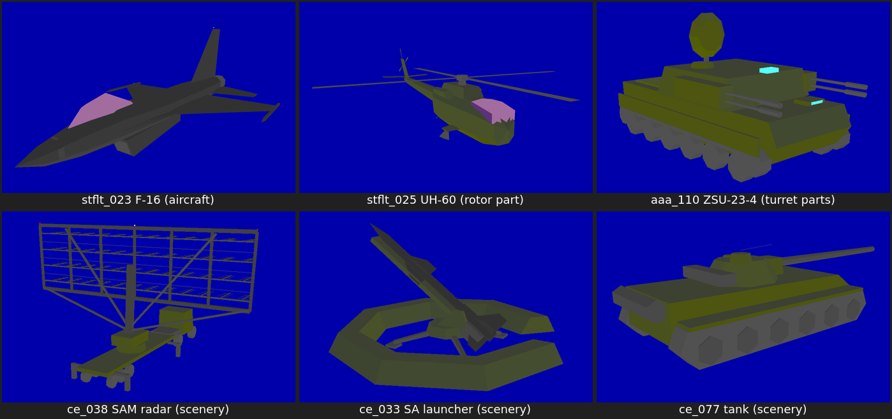
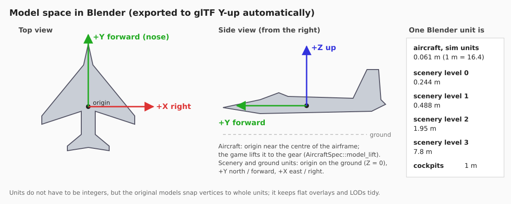
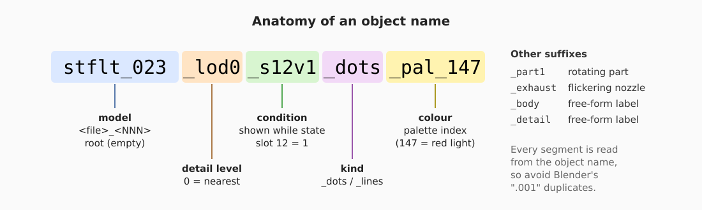
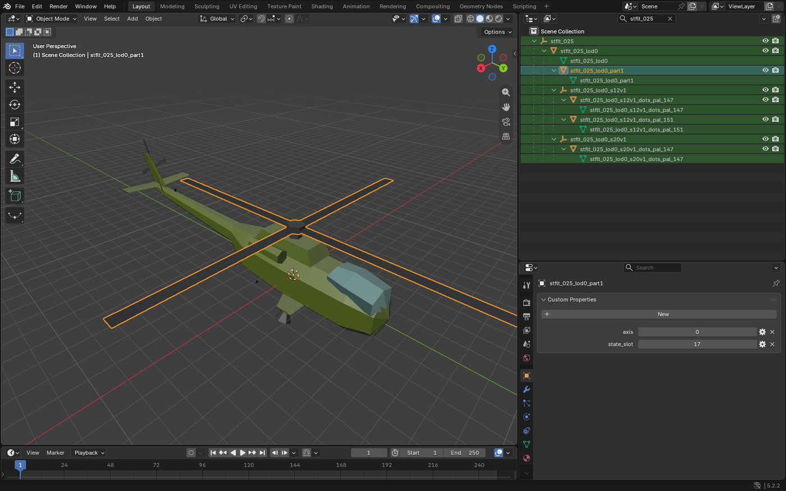
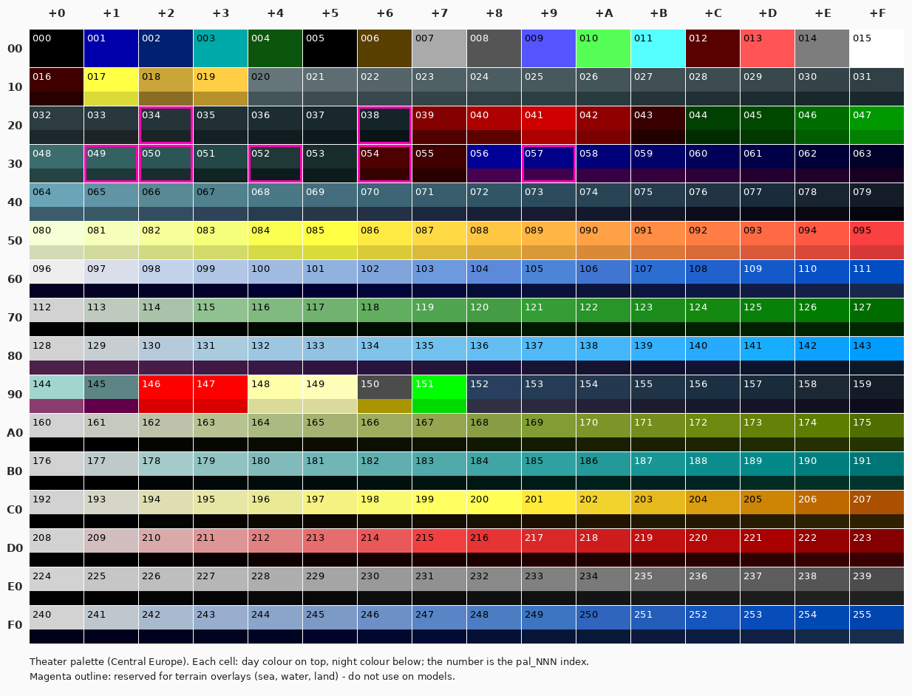
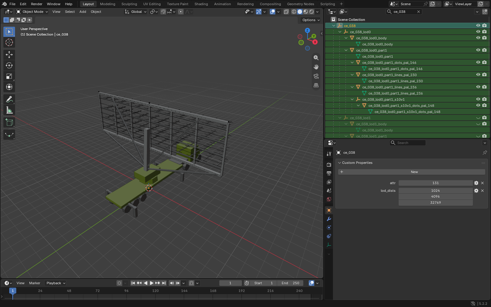
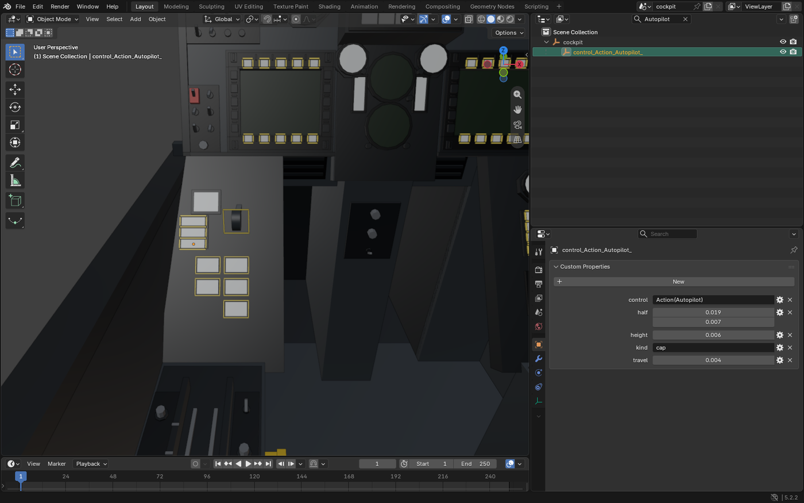

# Modelling for Stealth Mission 89

This guide shows how to build scenery objects, ground units, aircraft and cockpits by hand in
Blender so that the game can load them. It covers what the game reads from a `.blend` file:
object names, materials, custom properties and the object hierarchy. It also covers the extras:
navigation and anti-collision lights, night lights, engine flames, wrecks, rotors and radar
antennas, turrets, and cockpit buttons and levers.



The world models follow DOS-era aesthetics offlat-shaded polygon models, and new models should
to fit in with them. That means few polygons, flat colours from a 256-colour palette, and no
textures. The cockpits are the exception. They are ordinary PBR glTF models with normals, UVs
and textures.

## Contents

1. [How models get into the game](#how-models-get-into-the-game)
2. [Model space and scale](#model-space-and-scale)
3. [The object hierarchy](#the-object-hierarchy)
4. [Colours: the palette](#colours-the-palette)
5. [Geometry rules](#geometry-rules)
6. [Lines and dot lights](#lines-and-dot-lights)
7. [Conditional geometry and state slots](#conditional-geometry-and-state-slots)
8. [Rotating parts](#rotating-parts)
9. [Detail levels (LODs)](#detail-levels-lods)
10. [Collision hulls](#collision-hulls)
11. [Scenery objects](#scenery-objects)
12. [Ground units](#ground-units)
13. [Aircraft](#aircraft)
14. [Cockpits](#cockpits)
15. [Exporting and checking](#exporting-and-checking)
16. [Checklists](#checklists)

---

## How models get into the game

```
assets-src/blend/<file>.blend   ──tools/models/export.sh──▶   assets/models/<file>.glb
      (master, edit this)              (Blender, headless)            (shipped, loaded by the game)
```

Each `.blend` master holds **many models**, one per root object. The game looks a model up by
its root object's name, `<file>_<NNN>`. For example, `stflt_023` is the F-16 in `stflt.glb`
and `ce_038` is the SAM radar in Central Europe's `ce.glb`.

| File | Contents | Units |
|---|---|---|
| `stflt` | Aircraft, missiles, bombs, the F-117A's shadow | aircraft units |
| `ce`, `cu`, `ko`, `ku`, `lb`, `me`, `nc`, `pg`, `vn` | One per theater: terrain features, airbases, buildings, SAM sites, vehicles, ships | scenery level units |
| `photo` | Stand-ins for recon photo targets | scenery level units |
| `drones` | The remake's own aircraft (Geran drones, the Mi-24 Hind), numbered from 100 | aircraft units |
| `aaa` | The remake's low-level air defences (Shilka, S-60, MANPADS, Patriot, Gepard), from 110 | aircraft units |
| `cockpit_modern`, `cockpit_classic`, `cockpit_f16` | Flyable aircraft cockpits | metres |

Some files are generated by scripts in `tools/models/` (`drones.py`, `air_defence.py`,
`build_cockpit_f16.py`, ...), and some models are rebuilt inside a master by one (`uh60.py`). The helicopters (`uh60.py`,
`mi24.py`) share their fuselage, rotor and light helpers in `heli.py`. Read those scripts for worked examples of every convention in
this guide. For hand modelling, work in a master `.blend` and run the exporter.

The export settings matter, so always use the script and never export from the File menu by
hand. World models are exported **without normals, UVs or textures**, with loose edges and
loose vertices kept, and with custom properties written as glTF "extras".

---

## Model space and scale



All models use Blender's own axes: **+X right (east), +Y forward (north, the nose), +Z up**.
The exporter converts them to glTF's Y-up frame, so don't rotate anything to compensate.

The scale is **not metres** for the world models. One Blender unit is:

| Kind | One unit | One metre |
|---|---|---|
| Aircraft, weapons, `drones`, `aaa` (all simulation objects) | 0.061 m (1/8 of a world unit) | 16.4 units |
| Scenery on level 0 | 0.244 m | 4.1 units |
| Scenery on level 1 (most buildings, SAM sites, vehicles) | 0.488 m | 2.05 units |
| Scenery on level 2 (large features: towns, forests, power plants) | 1.95 m | 0.51 units |
| Scenery on level 3 / 4 (mountains, coastlines) | 7.8 m / 31 m | |
| Cockpits | 1 m | 1 unit |

A scenery model doesn't know its own level. The theater file places it on a level, and that
level sets its scale. Check which level the model will be used on before you start, or copy
the size of a similar existing model.

Keep object **scale at 1** and rotation at 0 on the root and LOD objects: apply transforms
(Ctrl+A) before exporting. Rotating parts are the exception, because their origin and rotation
are their pivot (see [Rotating parts](#rotating-parts)).

The models don't have to keep every vertex on whole units, but whole units make stacked
ground overlays and LODs line up cleanly. Use **Snap to Increment** with a grid of 1.

---

## The object hierarchy

Everything the game needs to know about a part is written into its **object name**:



A model is a tree of objects:

```
stflt_025                         Empty    root: attr, lod_dists
├─ stflt_025_lod0                 Mesh     detail level 0: max_dist, radius
│  ├─ stflt_025_lod0_lines_pal_175 Mesh    door and panel seams (loose edges)
│  ├─ stflt_025_lod0_part1        Mesh     main rotor: state_slot 17, axis 0
│  ├─ stflt_025_lod0_part2        Mesh     tail rotor: state_slot 17, axis 1 (canted)
│  ├─ stflt_025_lod0_s12v1        Empty    shown while navigation lights are on
│  │  ├─ ..._s12v1_dots_pal_147   Mesh     red dot lights (vertices only)
│  │  └─ ..._s12v1_dots_pal_151   Mesh     green dot lights
│  └─ stflt_025_lod0_s20v1        Empty    shown while the red beacon flashes
│     └─ ..._s20v1_dots_pal_147   Mesh     beacon dot lights
├─ stflt_025_lod1                 Mesh     coarser level, with its own parts and lights
└─ stflt_025_lod2                 Mesh     coarsest level (max_dist 32769)
```

The UH-60 is generated by `tools/models/uh60.py`, which rebuilds it inside `stflt.blend`; the AH-1Z
(`stflt_043`, the same tree with the tail rotor on the left of the fin, uncanted) by
`tools/models/ah1z.py`.

This is how the older single-level UH-60 looked in Blender (rotor selected, with its custom
properties):



Name each child after its parent plus a suffix, as above. Only the suffixes count, but full
names keep the outliner readable and stay unique across the whole file.

**Avoid Blender's `.001` duplicate names.** The game reads everything from the name, and some
suffixes (`_exhaust`) only work at the very end of the name. After duplicating, rename.

Custom properties are set in **Object Properties → Custom Properties → New**. Use the type the
tables below give. Integer arrays such as `lod_dists` are "Int Array" properties with the right
length. Nested arrays (`planes`) are easiest to set from Python (see
[Collision hulls](#collision-hulls)).

### Root object: `<file>_<NNN>`

An **Empty** at the model origin.

| Property | Type | Meaning |
|---|---|---|
| `attr` | int | Attribute byte. Bits 0-2: size class (sets how fast distance haze swallows the model: 0 tiny ... 7 huge). `0x10`: a target. `0x20`: the model has its own wreck (`_s1v1`, see below). `0x80`: set on all aircraft. **Copy it from a similar existing model** and adjust the size class. |
| `lod_dists` | int array | The `max_dist` of each detail level, in order (for reference; the game reads `max_dist` on the levels). |

### Detail levels: `<root>_lod<N>`

A **Mesh** (or an Empty, with the geometry in `_body` children). It is a direct child of the
root, numbered from 0 (nearest). Its own triangles are the model's main body.

| Property | Type | Meaning |
|---|---|---|
| `max_dist` | int | Farthest camera distance for this level, in model units (see [LODs](#detail-levels-lods)). 32769 on the last level. |
| `radius` | int | Distance from the origin to the farthest vertex (only needed with `planes`). |
| `planes` | array of [nx, ny, nz, d] | Collision hull (scenery only, optional). |

### Children of a level

| Suffix | Kind | What the game does with it |
|---|---|---|
| *(anything, e.g. `_body`, `_detail`)* | Mesh or Empty | Ordinary geometry, always shown with its level. |
| `_s<slot>v<value>` | Mesh or Empty | Shown only while state slot `slot` equals `value` ([Conditional geometry](#conditional-geometry-and-state-slots)). Several in one name are ANDed: `_s1v0_s10v1`. |
| `_part<N>` | Mesh | Rotates with a state slot about its own origin ([Rotating parts](#rotating-parts)). Needs `state_slot` and `axis`. |
| `_lines_pal_NNN` | Mesh, loose edges only | Edges drawn as lines in colour NNN ([Lines](#lines-and-dot-lights)). |
| `_dots_pal_NNN` | Mesh, loose vertices only | Each vertex is a point light in colour NNN that always shows a few pixels across ([Dot lights](#lines-and-dot-lights)). |
| `_exhaust` | Mesh | Jet nozzle exit: flickers light red / yellow like an afterburner. |

These can nest to any depth. For example, a radar dish part can carry its own night lights:
`ce_038_lod0_part1` → `ce_038_lod0_part1_s10v1` → `ce_038_lod0_part1_s10v1_dots_pal_148`.

---

## Colours: the palette

The world models have **no textures and no lighting colours of their own**. Each face takes one
colour from the theater's 256-colour palette, which shifts from day through dusk to night during
a mission. A face's colour comes from its **material name**: `pal_NNN` with a three-digit
index, e.g. `pal_226`. The Blender material's own colour is ignored. Set its Viewport Display
colour to match the chart below so the model looks right in Blender.



How to use it:

- **Each row from `A0` down is a ramp** from light to dark: olive drab (`A0`-`AF`), teal
  (`B0`), sand and yellow (`C0`), red (`D0`), **greys (`E0`-`EF`, the workhorse)** and blue-grey
  (`F0`). Other rows hold sky, ground and water colours and are better avoided for objects.
- **Shade by hand.** The classic renderer doesn't light faces, so the form only shows through
  your choice of shade. Pick a lighter shade of the ramp for faces turned towards the light
  (up and towards -X/+Y) and a darker one for faces turned away. The modern shader adds a little
  sun shading on top. Look at `mklib.Ramp` in `tools/models/mklib.py`, which does this from
  the face normal.
- **Night colours.** Most colours go dark at night (the lower half of each chart cell). The
  light colours keep their brightness and are the ones for lights:

  | Index | Colour | Typical use |
  |---|---|---|
  | 146 | red | Obstacle lights on towers, masts, buildings |
  | 147 | red | Port (left) navigation light, red beacons |
  | 148 | warm white | Floodlights, airfield and town night lights |
  | 149 | pale white | Steady white lights |
  | 151 | green | Starboard (right) navigation light |
  | 015 | white | Strobes |
  | 150 | dark glass by day, amber at night | Lit windows |
  | 013 / 017 | light red / yellow | Engine flames (they flicker) |

- **Don't use** 034, 038, 049, 050, 052, 054 and 057 (outlined magenta in the chart). The
  terrain uses them for its water and land overlays.
- Canopy glass on aircraft: use 144 / 145. The F-16 hides its exterior canopy by these colours
  when you sit in the cockpit (`CockpitView::canopy_colours`).

The palettes differ a little between theaters (`assets/palettes/tod_<theater>.ron`), but the
ramps sit at the same indices in all of them.

A mesh can use several `pal_` materials. Assign them per face as usual (material slots, Ctrl+L
links, etc.).

---

## Geometry rules

- **Low poly.** The F-16 is currently under 400 triangles, anything above 2000 polys starts to
  look out of place; Fine detail goes into lines and a second, darker shade, not into polygons.
- **Back faces are culled.** Every face must point outward: turn on *Viewport Shading → Backface
  Culling* while you model, and use *Mesh → Normals → Recalculate Outside*. Faces seen from both
  sides (fins, rotor blades, wings modelled as a sheet, signboards) need two faces back to back.
  Duplicate the face and flip the copy (`mklib.Geo.face2` does this).
- **No normals, UVs, modifiers or textures** are exported. Smooth shading has no effect. **Apply
  all modifiers** (Mirror especially) before export, because the exporter doesn't.
- **Ngons are fine.** They are triangulated on export. Keep them planar.
- **Ground overlays** (runways, roads, aprons, markings, building footprints) are flat faces on
  the ground. Stack them a few hundredths of a unit apart, in painting order (the topmost
  marking highest). A mesh whose vertices are all within 1 unit of the ground counts as a flat
  overlay. It casts no shadow and is not warm in the FLIR picture.
- **Heat.** In the FLIR (infrared) view, aircraft, vehicles and building-sized scenery (under
  500 m across, 250 m high) look warm. Terrain features don't. This is determined by size, so
  there's nothing to set.

---

## Lines and dot lights

Thin things (antenna arrays, masts, wires, lattice towers, rotor blades seen far away, runway
edge markings) are cheaper and look better as **lines**:

- Make a separate mesh object containing **only loose edges** (no faces). In Edit Mode, add
  vertices and connect them with F, or delete faces with "Only Edges & Faces".
- Name it `<parent>_lines_pal_NNN`, where NNN is the line colour. One object per colour.
- Lines stay one pixel wide at every distance.

**Dot lights** are point lights that always show a few pixels across, at any distance. They are
fullbright: they don't fade at night and stay visible through haze longer than geometry. They
are used for navigation lights, beacons, strobes, airfield lights and the faint dot a distant
object becomes:

- Make a mesh object containing **only vertices**. One vertex = one light.
- Name it `<parent>_dots_pal_NNN` with a light colour from the table above. One object per
  colour.
- Lift lights 1-2 units off the skin so they aren't hidden inside it.
- The coarsest LOD of many scenery models is just one dot: `ce_038_lod2_dots_pal_183`.

Put lights that should only show at certain times under a condition Empty (next section).

---

## Conditional geometry and state slots

Every model instance carries 32 small **state slots** that the game sets every frame. A child
named `_s<slot>v<value>` (and everything under it) is shown only while that slot holds that
value. This is how lights switch on, wrecks replace intact models, gear comes down and flames
appear.

The usual pattern is an **Empty** carrying the condition, with the actual meshes under it:

```
ce_021_lod0_s1v0                 shown while intact
└─ ce_021_lod0_s1v0_dots_pal_146   red obstacle lights
ce_021_lod0_s1v1                 shown once destroyed (the wreck)
ce_021_lod0_s10v1                shown at night
└─ ce_021_lod0_s10v1_dots_pal_148  floodlights
```

The `conds` custom property you may see on such objects in the existing files is only for
information. The name is what counts.

| Slot | Set on | Values |
|---|---|---|
| 1 | Scenery, ground units, AAA | 0 intact, 1 destroyed. Put the intact-only parts in `_s1v0` and the wreck in `_s1v1`; parts in neither show in both states. Set `attr` bit `0x20` when the model has its own wreck (otherwise the game swaps in a generic rubble model). |
| 10, 11 | Scenery, aircraft | 1 when it's dark enough for lights. Use `_s10v1` for night lights; `_s11v0` for daytime-only details. |
| 12 | Aircraft | 1 while navigation lights are on. |
| 13 | AI aircraft | 1 while airborne: engine flame (`_s13v1`, flickers like `_exhaust`). |
| 14 | Missiles | 1: rocket motor flame (`_s14v1`). |
| 5, 6, 7, 8 | The player's aircraft | 5: gear not up (1); 6: gear step while moving (0, 1, 2); 7: brakes on the ground; 8: weapon bay doors (0 closed, 1, 2 open). |
| 18 | Aircraft | White strobe, single flash once a second (fighters' fin tips). |
| 19 | Aircraft | White strobe, double flash (transports' wingtips). |
| 20 | Aircraft | Red rotating beacon (top and bottom of the fuselage). |
| 15, 16 | Everything (global) | Continuously turning angles for radar antennas (16 is the usual one). |
| 17 | Aircraft | Rotor and propeller angle. |
| 21, 22 | AAA units | Turret azimuth, gun elevation (aimed at the target). |

Slots 15-17 and 21-22 are angles for [rotating parts](#rotating-parts), not values to test.

To see the conditions in the [model viewer](#exporting-and-checking), press **L** to toggle
lights (slots 10 and 12, plus flashing 18-20) and **D** to toggle destroyed (slot 1).

---

## Rotating parts

A rotor, propeller, radar antenna, turret or gun barrel is a **mesh child named `_part<N>`**
(N just numbers the parts: `_part1`, `_part2`, ...). It turns about **its own object origin**,
on one of **its own local axes**:

| Property | Type | Meaning |
|---|---|---|
| `state_slot` | int | Slot giving the angle: 16 radar antenna (turns all the time), 17 rotor/propeller, 21 turret yaw, 22 gun elevation. |
| `axis` | int | 0 = about local Z (yaw: rotors, radar antennas, turrets), 1 = about local X (pitch: gun barrels, launcher rails), 2 = about local Y (roll: pusher propellers). |

How to set one up:

1. Model the part in place, in its rest position.
2. Set its origin to the pivot: put the 3D cursor on the hub or trunnion, then use *Object → Set
   Origin → Origin to 3D Cursor*.
3. Parent it to the LOD (or to another part: a gun is a child of its turret, so it turns with
   it and elevates on its own).
4. Add `state_slot` and `axis`.

The part's rotation in Blender is its rest pose, and the spin is added on top of it about the
part's local axis. A tilted rotor therefore spins about its tilted mast. Lights and lines that
should turn with the part go under it, like the radar's night light above. The SAM radar site
in Blender, with its LODs and the turning antenna part:



Press **A** in the model viewer to animate the parts.

---

## Detail levels (LODs)

Far-away models switch to simpler levels. Level `_lod0` is shown from 0 up to its `max_dist`,
`_lod1` from there to its own `max_dist`, and so on. The last level should have `max_dist`
32769 ("forever"). The game multiplies all distances by 4 (and by the player's detail setting),
so `max_dist` 1024 on a level-1 SAM site means about 2 km.

Typical sets:

| Model | Levels |
|---|---|
| Aircraft, AAA | `lod0` only (32769), or `lod0` (16000) + a simple `lod1` |
| Building, SAM site | `lod0` (256-1024) full detail, `lod1` (2048-4096) main shapes, last level a single dot |
| Airbase | 3-4 levels, dropping markings and lights first |

Every level needs its own lights and conditions. Copy the condition Empties down to each level
and thin them out. A level that is only a dot keeps the model visible at long range without
cost.

---

## Collision hulls

Only **scenery** collides (the player flying into a building or a mountain). Ground units,
aircraft and AAA don't. Leave `planes` off and nothing collides with the model. If you want
collision, give each LOD level:

- `radius`: the farthest vertex from the origin, in model units.
- `planes`: a convex hull as a list of `[nx, ny, nz, d]`. The point is inside when `n·p + d < 0`
  for every plane. The normal is scaled to length 16384 (and `d` with it) and written in the
  **exported Y-up frame** (glTF x = Blender x, y = Blender z, z = -Blender y).

The hull doesn't have to be tight (some current models use a handful of planes). Run this in
Blender's Python console with the LOD object selected. It uses the convex hull of the mesh:

```python
import bpy, bmesh
from mathutils import Vector

lod = bpy.context.object
bm = bmesh.new()
bm.from_mesh(lod.data)
for c in lod.children_recursive:          # include the _body etc. meshes
    if c.type == 'MESH' and '_pal_' not in c.name and '_s1v1' not in c.name:
        m = c.data.copy(); m.transform(lod.matrix_world.inverted() @ c.matrix_world)
        bm.from_mesh(m); bpy.data.meshes.remove(m)
hull = bmesh.ops.convex_hull(bm, input=bm.verts)
bmesh.ops.delete(bm, geom=[g for g in hull["geom_interior"] + hull["geom_unused"]], context='VERTS')
bm.faces.ensure_lookup_table()
planes = []
for f in bm.faces:
    n, p = f.normal, f.calc_center_median()
    n = Vector((n.x, n.z, -n.y)) * 16384          # Blender -> glTF frame, Q14 scale
    p = Vector((p.x, p.z, -p.y))
    planes.append([round(n.x), round(n.y), round(n.z), round(-n.dot(p))])
lod["planes"] = planes
lod["radius"] = int(max(v.co.length for v in bm.verts) + 1)
bm.free()
print(len(planes), "planes")
```

---

## Scenery objects

Buildings, bridges, towers, depots, tank farms, airbases, forests and terrain features go into
the theater file (`ce.blend`, `vn.blend`, ...). The level they will be placed on sets their units
(usually level 1: 1 unit = 0.49 m).

1. Pick the next free model number in that file and create the root Empty `ce_NNN` at the world
   origin, with `attr` and `lod_dists`.
2. Origin on the ground at the object's centre. **+Y is north**, and the model is placed without
   rotation, so orient it as it should stand on the map.
3. Model `lod0`. Ground footprint, aprons and markings are flat overlays at Z ≈ 0, stacked as
   described in [Geometry rules](#geometry-rules).
4. Add extras:
   - Red obstacle lights (`_dots_pal_146`) on tall structures, under `_s1v0` so they go out
     when it's destroyed.
   - Night lighting under `_s10v1`: floodlights (148) for airfields and industry, lit windows
     (faces in colour 150, or dots).
   - A wreck under `_s1v1` (lowered roof, broken shaft, dark colours 236-239), with the intact
     parts under `_s1v0` and `attr |= 0x20`.
   - Rotating radar antennas as `_part1` on slot 16.
5. Add coarser levels down to a dot, and optionally a collision hull.

A model only appears once a theater places it. Tile objects are listed by model number
(`shape`) and offset in the tile sets of `assets/theaters/<theater>.ron`. Numbers on levels 1
and 2 must stay below 128. The Ukraine theater shows how a generated theater adds its own
models and places them: `tools/theater_ua/models.py` and `assemble.py`.
`tools/models/control_tower.py` rebuilds one scenery model inside existing masters and is a
compact example of the intact, wreck and night-light structure.

---

## Ground units

There are two kinds, and they differ in units and in which slots move.

**Static units in the theater** (SAM launchers and radars, tanks, trucks, parked aircraft and
ships) are scenery models like the ones above: theater file, level units (usually level 1),
origin on the ground, +Y forward. They get slots 1 (destroyed), 10/11 (night) and 16 (radar
antenna). Examples: `ce_033` SAM launcher, `ce_038` SAM radar, `ce_076` mobile SAM, `ce_077` tank.

**Simulated air-defence units** (`aaa.glb`: Shilka, S-60, MANPADS team, Patriot, Gepard) are
simulation objects in **aircraft units** (1 m = 16.4 units). They turn to face their target:

```
aaa_110                                Empty    attr 1, lod_dists [16000, 32769]
├─ aaa_110_lod0                        Empty    max_dist 16000
│  ├─ aaa_110_lod0_s1v0                Mesh     hull, tracks (intact)
│  │  └─ aaa_110_lod0_s1v0_part1       Mesh     turret: state_slot 21, axis 0
│  │     ├─ aaa_110_lod0_s1v0_part2    Mesh     guns: state_slot 22, axis 1
│  │     └─ aaa_110_lod0_s1v0_part3    Mesh     radar dish: state_slot 16, axis 0
│  └─ aaa_110_lod0_s1v1                Mesh     burnt-out wreck
└─ aaa_110_lod1                        Empty    max_dist 32769
   ├─ aaa_110_lod1_s1v0                Mesh     simplified
   └─ aaa_110_lod1_s1v1                Mesh
```

Model the turret and guns pointing straight ahead (+Y) and level. That is angle 0. The turret
origin goes on the turret ring and the gun origin on the trunnion. `tools/models/air_defence.py`
builds all of these and is a good reference for proportions. It works in metres and scales by
`K = 16.38`.

---

## Aircraft

Aircraft live in `stflt.blend` (or a file of their own, like `drones`). They use aircraft units
(1 m = 16.4 units) with +Y the nose and +Z up. The origin is the aircraft's reference point. For
the player-flyable aircraft, `AircraftSpec::model_lift` in `src/aircraft.rs` says how high it
sits above the ground, so either put the origin where the wheels touch or note the height.

An aircraft usually has one level, `lod0`, with `max_dist` 32769 and `attr` `0x8N`
(N = size class: 1 for drones and small fighters, 3 for fighters, more for bombers and
transports). The F-16's tree:

```
stflt_023                          attr 131, lod_dists [32769]
└─ stflt_023_lod0                  fuselage, wings, tail, canopy (pal_144/145)
   ├─ stflt_023_lod0_exhaust       nozzle exit faces: flicker red/yellow
   ├─ stflt_023_lod0_s12v1         navigation lights (Empty)
   │  ├─ ..._s12v1_dots_pal_147     left wingtip (red, -X)
   │  └─ ..._s12v1_dots_pal_151     right wingtip (green, +X)
   ├─ stflt_023_lod0_s13v1         afterburner flame cone, only airborne
   └─ stflt_023_lod0_s18v1         fin-tip strobe (Empty)
      └─ ..._s18v1_dots_pal_015     white
```

The extras, by aircraft type:

- **Navigation lights** (slot 12): red 147 on the left (-X) wingtip, green 151 on the right (+X).
  Use dots, or short `_lines_pal_147/151` along the wingtip edge for a light visible from the
  side.
- **Anti-collision lights**: fighters get a white strobe on the fin tip (`_s18v1`, colour 015)
  or a red beacon (`_s20v1`, 147). Transports and helicopters get red beacons top and bottom
  (`_s20v1`) and double-flashing white wingtip strobes (`_s19v1`), a few units behind the
  navigation lights. `tools/models/anticollision.py` places these automatically for the stock
  aircraft. Add a row to its `LIGHTS` table for a new one, or place them by hand.
- **Engine**: nozzle exit faces in a separate `_exhaust` mesh (always flickering). For AI
  aircraft, a flame cone behind it in `_s13v1` (shown only when airborne). Missiles use `_s14v1`
  for the motor flame.
- **Rotors and propellers**: `_part1` with `state_slot` 17. A helicopter main rotor uses axis 0
  (about the mast). Slot 17 turns parts clockwise seen along their local +Z (from above, for
  an unrotated rotor), as Soviet rotors turn; for an anticlockwise rotor, give the part a rest
  rotation of 180 degrees about X and build it upside down (`heli.flipped`). A pusher or tractor propeller uses axis 2 (fore-aft). Blades are thin
  sheets, so make them double-sided. Add a tail rotor as `_part2` with axis 1.
- **Player aircraft only**: landing gear in `_s5v1` (gear not up), the gear stages in
  `_s6v0/1/2`, brake details in `_s7v1`, and bomb bay doors in `_s8v0` (closed), `_s8v1`,
  `_s8v2` (open). See `stflt_024` / `stflt_031` / `stflt_033` (F-117A variants).

Wiring up a **new** aircraft takes code as well as the model. Sim objects pick their file by
model number (`model_file` in `src/sim_render.rs`: below 100 `stflt`, 100-109 `drones`, from
110 `aaa`), and a flyable aircraft needs an `AircraftSpec` in `src/aircraft.rs` (model, eye
point, cockpit file, flight model).

---

## Cockpits

Cockpits are full-detail glTF models in **metres**, exported with normals, UVs, materials and
textures (`tools/models/export_cockpit.py`). Nothing is generated at run time: every visible part
comes from the model. The game binds behaviour by **material name** and **custom properties**.



### Frame

- One root Empty named `cockpit`. **Its origin is the pilot's design eye point.** Model the
  cockpit around it: +Y forward, +Z up, X right, in metres. The game puts the root at the eye
  point of the aircraft (`AircraftSpec::eye`).
- Smooth shading, bevels, normal maps and textures all work, but apply modifiers before export.
- Mark small parts that needn't cast shadows with a bool property `no_shadow` (lamps, labels,
  button caps, highlight frames). This saves a lot of shadow-map work.

### Materials with a special meaning

| Material name | What it becomes |
|---|---|
| `panel_grey`, `dark`, `black`, `frame`, `seat`, `cushion`, `yellow`, `rubber`, `metal`, `highlight` | The shared cockpit materials (their look is set in code, so all cockpits match). |
| `swatch` | Solid parts coloured from the live palette. UV each face onto one cell of a 16×16 grid: index = row × 16 + column, row 0 at the top. In Blender UVs that is u = (column + 0.5) / 16, v = 1 − (row + 0.5) / 16. |
| `screen_left`, `screen_right`, `screen_third` | The MFDs. UVs 0..1 over the screen face. |
| `adi`, `approach`, `hsi`, `ded`, `screen_rwr` | Other live instruments (attitude, approach, HSI, data entry display, RWR scope). UVs 0..1. |
| `trackcam`, `trackcam_left`, `trackcam_third` | The tracking camera picture, a face a few mm behind the matching screen. |
| `hud_glass` | The HUD combiner glass. The HUD is drawn on it, collimated. |
| `atlas` | A lamp, readout, label or button face drawn live into the instrument atlas. Needs `atlas_face` (the face's key in `src/cockpit3d/layout.rs`, e.g. `Button(Auto, None)`) and `atlas_uv` ([u0, v0, u1, v1], the UV rectangle the face was mapped to, usually [0, 0, 1, 1]). |
| `label_<TEXT>` | A side panel label showing TEXT. |
| anything else | Used as modelled (base colour, roughness, metallic, textures). |

### Pushable controls

A button, switch, gear lever or ejection handle is an **Empty** whose **local +Z points out of
the panel face** (towards the pilot's finger):

```
control_Action_Autopilot_        Empty   control "Action(Autopilot)", kind "cap",
│                                        half [0.019, 0.007], height 0.006, travel 0.004
├─ highlight.066                 Empty   highlight = true  (shown while a VR fingertip touches it)
│  └─ highlight.067 ...          Mesh    thin frame around the cap, material "highlight"
└─ moving.012                    Empty   moving = true     (what moves when pressed)
   ├─ atlas.039                  Mesh    cap face: material "atlas", atlas_face "Button(Auto, None)"
   └─ dark.104                   Mesh    cap body
```

| Property | Type | Meaning |
|---|---|---|
| `control` | string | What it does: `Action(<name>)` (any action from `src/input.rs`, e.g. `Action(Gear)`, `Action(Chaff)`), `HudMode(0/1/2)`, `LeftPage(Map)` / `LeftPage(Tac)`, `CamCycle`, `TimeToggle`, `Osb(Left, 3)` (MFD bezel button; sides `Left`, `Right`, `Third`). |
| `kind` | string | `cap` (push button), `osb` (MFD bezel button), `side` (side panel button), `gear` (gear lever), `eject` (ejection handle, pulled up). |
| `half` | float array [2] | Half width and half height of the touch face, metres. |
| `height` | float | Face height above the Empty's origin along +Z, metres. |
| `travel` | float | How far the `moving` child sinks when pressed, metres. |

Without VR the controls are clicked with the mouse. In VR they're pressed with a fingertip,
which is why the touch face and the highlight are needed.

### Levers, lamps

| Object | Properties | Meaning |
|---|---|---|
| Stick | `stick` = true, optional `grip` (float, m) | The origin is the stick's pivot. It tilts for pitch and roll and twists for rudder. `grip` is the grip centre's height above the pivot (default 0.11 m). |
| Throttle | `throttle` = true | The origin is the handle at idle. |
| Throttle end | `anchor` = `"throttle_full"` | An Empty where the handle is at full thrust. The handle slides between the two. |
| Flood lamp | `lamp` ([r, g, b], linear), `range` (m) | A point light, used with the local lights option. |

### Panel layouts

The F-117A's modern panel and the F-16's panel are generated from a layout by
`tools/models/build_cockpit_f117.py` / `build_cockpit_f16.py`, from
`assets-src/blend/cockpit_*_layout.json`. A test keeps those layouts in step with
`src/cockpit3d/layout.rs`. To move a button on those panels, change the layout and rebuild
rather than editing the `.blend`, or your edit will be overwritten. A new hand-made cockpit can
reuse any face key that exists in `layout.rs`. New faces (a new lamp or readout) need a code
change there.

A new cockpit file is used once an `AircraftSpec` lists it in `cockpits`, and it is exported
by `export.sh` once its name (`cockpit_*`) is added to the script's default list.

---

## Exporting and checking

Export one or more masters (Blender must be on the `PATH`):

```sh
tools/models/export.sh ce             # assets-src/blend/ce.blend -> assets/models/ce.glb
tools/models/export.sh stflt ce aaa   # several
tools/models/export.sh                # everything in the default list
```

A new master file has to be added to the default list in `tools/models/export.sh`. The script
records a checksum in `assets-src/blend/<file>.stamp`. Commit the `.blend`, the `.glb` and the
`.stamp` together.

The masters for `drones`, `aaa` and the Ukraine theater are rebuilt by their scripts, not
edited by hand (see the docstrings of `tools/models/drones.py`, `air_defence.py` and
`tools/theater_ua/build.sh`).

Then look at the result in the **model viewer**:

```sh
cargo run --release -- --viewer --file ce --model 38
```

`--model` is the index of the model in the file (its position in the outliner order), which is
usually but not always its number. Other options: `--yaw`, `--pitch` (degrees), `--distance`,
`--lights`, `--no-label`.

| Key | Action |
|---|---|
| PgUp / PgDn | Previous / next model |
| Tab | Next file |
| Drag, wheel | Orbit, zoom (zoom out to see the LODs switch) |
| L | Lights on/off (night lights, navigation lights, flashing anti-collision lights) |
| D | Destroyed variant |
| A | Animate parts (rotors, radar antennas) |
| P | Day / dusk / night palette |
| R | Remap table (detail levels, FLIR) |

The viewer's palette is not exactly the in-flight one, so check colours in a mission too.

---

## Checklists

**Every world model**

- [ ] Root Empty `<file>_<NNN>` at the origin with `attr` and `lod_dists`.
- [ ] Levels `<root>_lod0` … with `max_dist`, the last one 32769.
- [ ] Correct units for the kind of model; transforms applied; +Y forward / north.
- [ ] All face materials are `pal_NNN`; no reserved overlay colours.
- [ ] Faces point outward; double-sided sheets doubled; modifiers applied.
- [ ] Lines and dots in separate loose-edge / loose-vertex objects named `_lines_pal_NNN` /
      `_dots_pal_NNN`.
- [ ] No `.001` names.

**Scenery / ground units**

- [ ] Origin on the ground; overlays stacked a little apart.
- [ ] Intact `_s1v0` / wreck `_s1v1`, `attr` bit `0x20`.
- [ ] Night lights under `_s10v1`; obstacle lights on tall things.
- [ ] Radar antennas as `_part` on slot 16; turret/gun parts with origins at their pivots.
- [ ] Coarser LODs down to a dot; optional `planes` + `radius`.

**Aircraft**

- [ ] Navigation lights (147 left, 151 right) under `_s12v1`.
- [ ] Anti-collision lights under `_s18v1` / `_s19v1` / `_s20v1`.
- [ ] `_exhaust` nozzle, `_s13v1` flame; rotors as `_part` on slot 17.
- [ ] Canopy in 144/145.

**Cockpits**

- [ ] Root Empty `cockpit` at the design eye point; metres.
- [ ] Screens and instruments with their material names and 0..1 UVs.
- [ ] Every control: Empty with +Z out of the panel, the five properties, `moving` and
      `highlight` children.
- [ ] `stick`, `throttle`, `throttle_full`; `no_shadow` on small parts.
